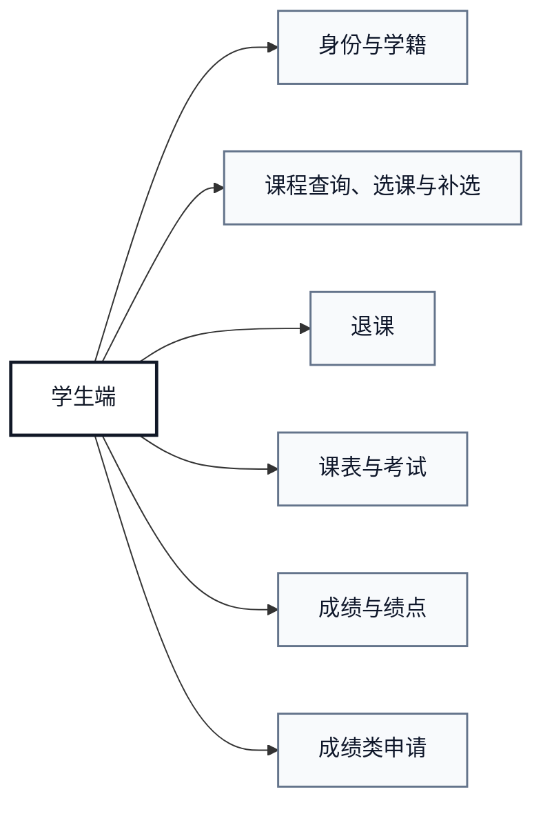
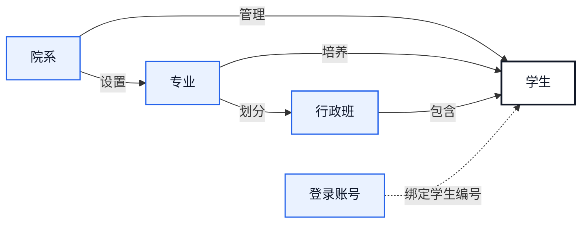
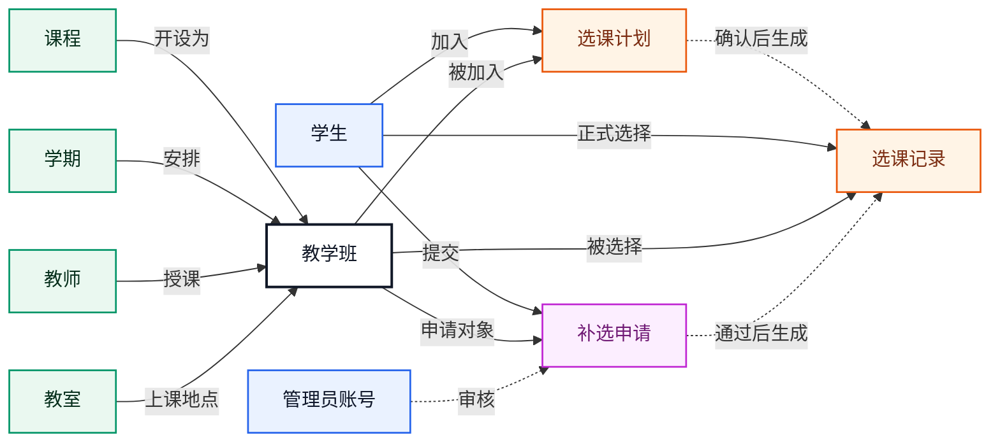
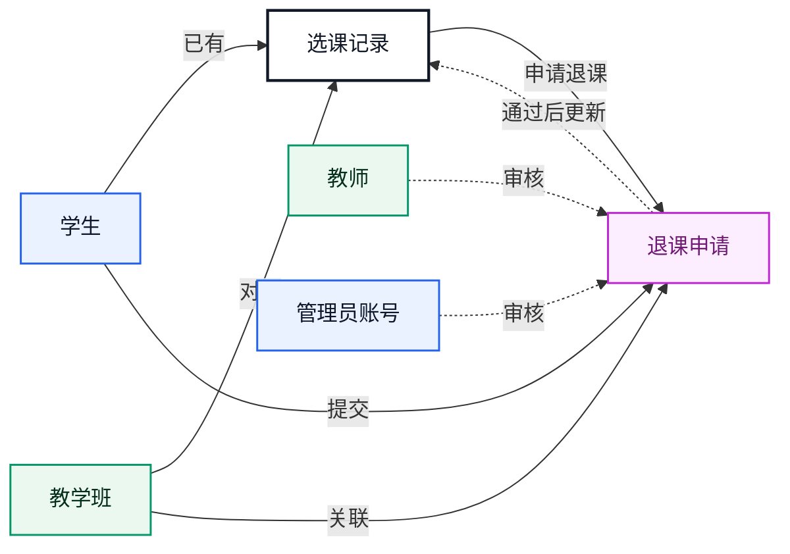
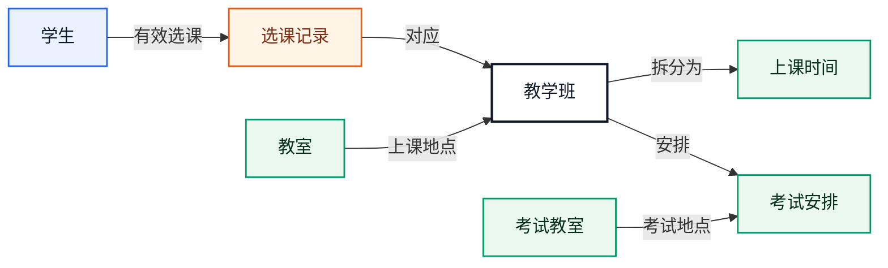
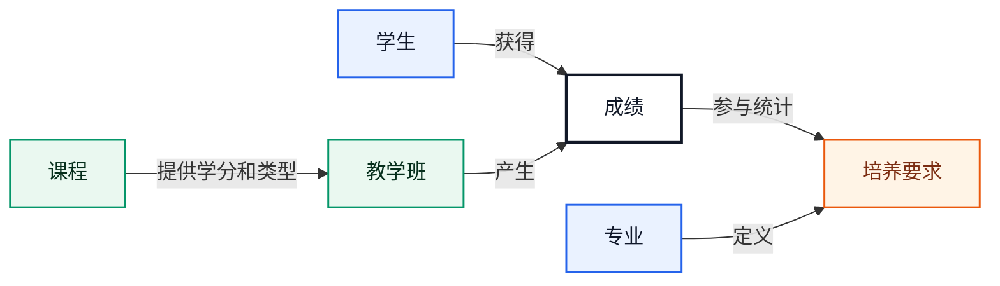
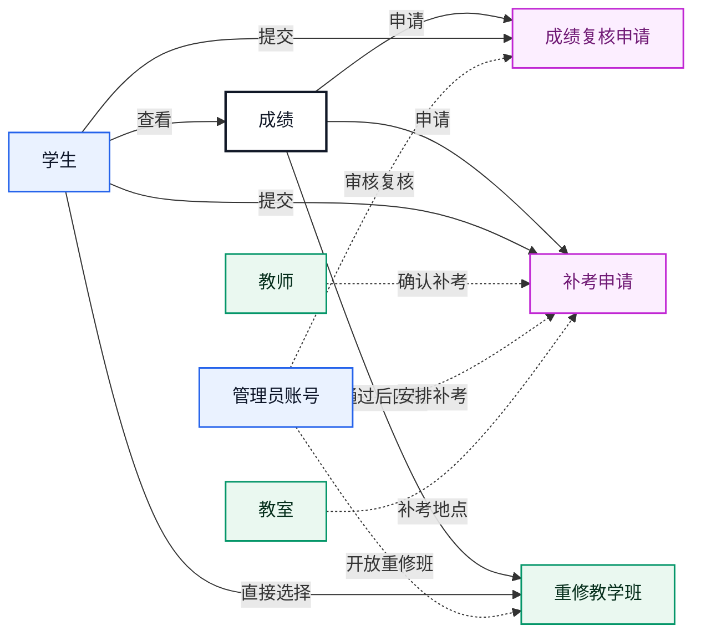

# 学生端开发报告

## 一、模块概述

学生端是教学事务管理系统面向学生用户的业务模块，覆盖学生在校期间最常用的个人信息维护、选课、选课计划、已选课程查看、退课、学期总览、课表查看、考试安排、成绩查询、绩点统计、补考重修、学业进度和成绩复核申请等功能。

系统整体采用 Vue 前端、Spring Boot 后端和 MySQL 数据库。学生端页面集中在 `frontend/src/views/student`，前端接口封装在 `frontend/src/api/student.js`，后端控制器、服务和数据访问逻辑集中在 `com.school.student` 包。补选申请、退课申请和成绩复核申请属于学生发起、管理员审核的协作流程，学生端负责提交申请和查看结果，管理员端负责审批并写入处理意见。

学生端当前重点完成了以下能力：

- 学生身份识别和接口访问边界控制。
- 学生个人资料查看与联系方式维护。
- 可选课程查询和直接选课。
- 选课容量、时间冲突和重复选课校验。
- 选课计划暂存、一键选课和计划课表预览。
- 补选申请提交和进度查看。
- 学业进度与已选课程合并展示，支持按专业、课程类型和学期折叠查看课程状态。
- 按时间规则直接退课或提交退课申请。
- 学期总览、考试安排和课程明细统一查看。
- 学生个人课表查看。
- 课表、学期课表和成绩单浏览器打印导出，打印版控制在单页内。
- 已提交成绩查询、等级展示、成绩状态展示和加权绩点统计。
- 补考申请、补考记录查看和开放重修班直接选课。
- 培养方案完成度和学业进度统计。
- 成绩复核申请提交、状态查看和管理员审批闭环。

## 二、实体设计

学生端实体设计围绕“学生、课程、教学班、选课、退课、成绩、申请、学期、考试和培养方案”展开。学生通过教学班参与课程学习，通过申请表完成需要审核的特殊业务，并通过考试安排和培养要求查看学习过程与完成情况。

### 1. 学生实体

`student` 表表示学生基础资料，包括学号、姓名、性别、出生日期、所属班级、专业、院系、状态、手机号和邮箱。

学生端以当前登录用户对应的学生编号作为身份边界。后端优先通过请求头中的 `X-Username` 查询 `sys_user.ref_id` 得到学生编号，兼容保留 `X-Student-Id` 和请求体 `studentId` 作为旧接口回退方式。

### 2. 课程实体

`course` 表表示课程基础信息，包括课程编号、课程名称、课程类型、学分、学时、考核方式、开课院系和课程状态。

学生端课程查询会展示课程类型、学分、教师、学期、教学班容量和当前选课状态，帮助学生判断是否可以选课或是否需要发起补选申请。

### 3. 教学班实体

`teaching_class` 表表示一门课程在某一学期下的具体教学安排。

主要信息包括：
- 教学班编号。
- 所属学期。
- 课程编号。
- 任课教师。
- 教室。
- 开课日期。
- 星期、节次和周次。
- 容量上限和已选人数。
- 教学班状态。

学生端的可选课程、已选课程、退课列表、课表和成绩都围绕教学班组织。

### 4. 选课实体

`course_selection` 表记录学生和教学班之间的选课关系，通过 `selection_status` 表示当前状态。

主要状态包括：
- `已选`：学生当前仍在教学班中。
- `已退`：学生曾经选择该教学班，但已经退课。

系统保留退课记录，不直接删除选课关系。学生重新选择同一教学班时，系统恢复原记录为 `已选`，并清理旧成绩，避免退课前成绩继续影响重新选课后的成绩查询。

### 5. 补选申请实体

`course_selection_request` 表表示学生补选申请。

当课程无法直接选择但仍允许申请时，学生可以提交补选申请，说明申请原因。管理员审核通过后，系统为学生加入对应教学班；审核驳回时，学生可查看驳回原因。

### 6. 退课申请实体

`course_drop_request` 表表示学生退课申请。

退课根据开课时间分为三类：
- 开课后一周内允许学生直接退课。
- 开课后一到三周内需要提交退课申请。
- 开课三周后禁止退课。

退课申请保存申请原因、审核状态、审核意见、审核人和审核时间。退课通过后，选课状态更新为 `已退`，对应成绩记录被清理。

### 7. 成绩实体

`score` 表保存学生在教学班中的成绩信息，包括平时成绩、考试成绩、总评成绩、绩点、是否提交和录入时间。

学生端只展示已经提交的成绩。总评成绩和绩点由数据库触发器根据平时成绩和考试成绩计算，避免前后端分别计算造成结果不一致。

绩点换算采用 11 档规则：
- `>= 90`：`4.0`
- `>= 85`：`3.7`
- `>= 82`：`3.3`
- `>= 78`：`3.0`
- `>= 75`：`2.7`
- `>= 72`：`2.3`
- `>= 68`：`2.0`
- `>= 66`：`1.7`
- `>= 64`：`1.5`
- `>= 60`：`1.0`
- `< 60`：`0.0`

### 8. 成绩复核申请实体

`score_review_request` 表表示学生对已提交成绩发起的复核申请。

该实体记录申请对应的成绩、学生、申请原因、审核状态、审核意见、审核人、申请时间和审核时间。系统限制学生只能对本人已提交成绩发起复核，并阻止同一成绩存在重复待审核申请。

### 9. 学期实体

`semester` 表表示学期设置。学生端主要使用学期名称、选课时间、课程开课日期和教学班所属学期信息，用于课程筛选、课表展示、退课时间判断和成绩统计。

## 三、学生端 ER 图与数据库设计

### 1. 学生端 ER 图

为避免单张 ER 图过于拥挤，本节采用“总览图 -> 功能图 -> 实体属性表”的层级方式展示学生端数据模型。总览图只说明学生端包含哪些业务功能；每个功能单独绘制小型实体关系图；实体属性不放入图中，而是在对应功能下用表格列出。

#### 1.1 学生端功能总览图

#### 1.2 身份与学籍功能图

身份与学籍功能用于确定当前登录用户对应的学生身份，并说明学生在院系、专业和行政班中的组织归属。

| 中文实体 | 数据表 | 主要属性 |
| --- | --- | --- |
| 学生 | `student` | 学号、姓名、性别、入学年份、院系、专业、行政班、学籍状态、联系方式 |
| 院系 | `department` | 院系编号、院系名称、办公地点、联系电话 |
| 专业 | `major` | 专业编号、专业名称、所属院系 |
| 行政班 | `class_info` | 班级编号、班级名称、年级、所属专业、辅导员 |
| 登录账号 | `sys_user` | 用户编号、登录账号、真实姓名、用户类型、关联业务编号、启用状态 |

#### 1.3 课程查询、选课与补选功能图

课程查询、选课与补选功能围绕“学生选择教学班”展开。课程是教学内容，教学班是课程在某个学期、由某位教师开设的具体班级；选课计划表示暂存意向，选课记录表示正式选课结果；当学生不能直接选课但允许申请时，通过补选申请进入审核流程。

| 中文实体 | 数据表 | 主要属性 |
| --- | --- | --- |
| 学生 | `student` | 学号、姓名、学籍状态 |
| 课程 | `course` | 课程编号、课程名称、课程类型、学分、学时、考核方式、开课院系 |
| 学期 | `semester` | 学期编号、学期名称、起止日期、选课开始时间、选课结束时间 |
| 教师 | `teacher` | 教师工号、姓名、职称、所属院系、在职状态 |
| 教室 | `classroom` | 教室编号、教学楼、教室名称、容量 |
| 教学班 | `teaching_class` | 教学班编号、学期、课程、教师、教室、开课日期、容量上限、已选人数、状态 |
| 选课计划 | `student_course_plan` | 计划编号、学生、教学班、创建时间 |
| 选课记录 | `course_selection` | 选课记录编号、学生、教学班、选课时间、选课状态 |
| 补选申请 | `course_selection_request` | 申请编号、学生、教学班、申请原因、申请状态、审核意见、审核人、申请时间、审核时间 |
| 管理员账号 | `sys_user` | 用户编号、登录账号、真实姓名、用户类型 |
#### 1.4 退课功能图

退课功能以已存在的选课记录为前提。允许直接退课时系统更新选课状态；需要审核时学生提交退课申请，由教师或管理员完成审核。

| 中文实体 | 数据表 | 主要属性 |
| --- | --- | --- |
| 学生 | `student` | 学号、姓名、学籍状态 |
| 教学班 | `teaching_class` | 教学班编号、课程、学期、教师、开课日期、状态 |
| 选课记录 | `course_selection` | 选课记录编号、学生、教学班、选课时间、选课状态 |
| 退课申请 | `course_drop_request` | 退课申请编号、学生、教学班、退课原因、申请状态、教师审核状态、管理员审核状态、审核意见 |
| 教师 | `teacher` | 教师工号、姓名、所属院系 |
| 管理员账号 | `sys_user` | 用户编号、登录账号、真实姓名、用户类型 |

#### 1.5 课表与考试功能图

课表功能从学生的有效选课记录出发，找到教学班和对应上课时间；考试安排与教学班保持一对一关系，并关联考试教室。

| 中文实体 | 数据表 | 主要属性 |
| --- | --- | --- |
| 学生 | `student` | 学号、姓名 |
| 选课记录 | `course_selection` | 学生、教学班、选课状态 |
| 教学班 | `teaching_class` | 教学班编号、课程、学期、教师、教室、周次范围 |
| 上课时间 | `teaching_class_session` | 上课时间编号、教学班、星期、节次、单双周类型、排序号 |
| 教室 | `classroom` | 教室编号、教学楼、教室名称、容量 |
| 考试安排 | `exam_arrangement` | 考试编号、教学班、考试日期、开始时间、结束时间、考试教室、考试状态 |

#### 1.6 成绩与绩点功能图

成绩功能以学生和教学班的学习结果为核心。成绩记录用于展示平时成绩、考试成绩、总评成绩和绩点，并可进一步参与培养要求统计。

| 中文实体 | 数据表 | 主要属性 |
| --- | --- | --- |
| 学生 | `student` | 学号、姓名、专业、入学年份 |
| 教学班 | `teaching_class` | 教学班编号、课程、学期、教师 |
| 课程 | `course` | 课程编号、课程名称、课程类型、学分、成绩比例 |
| 成绩 | `score` | 成绩编号、学生、教学班、平时成绩、考试成绩、总评成绩、绩点、提交状态、录入时间 |
| 专业 | `major` | 专业编号、专业名称 |
| 培养要求 | `cultivation_plan_requirement` | 要求编号、入学年份、专业、课程类型、应修学分、备注 |

#### 1.7 成绩类申请功能图

成绩类能力包括成绩复核、补考和重修。成绩复核与补考以成绩记录为依据，由学生发起申请，并由管理员或教师完成后续审核、确认和安排；重修在当前实现中不再由学生提交独立申请，而是在管理员开放重修教学班后，由学生直接对重修班选课。

| 中文实体 | 数据表 | 主要属性 |
| --- | --- | --- |
| 学生 | `student` | 学号、姓名 |
| 成绩 | `score` | 成绩编号、学生、教学班、总评成绩、绩点、提交状态 |
| 成绩复核申请 | `score_review_request` | 申请编号、学生、成绩、复核原因、申请状态、审核意见、审核人、申请时间、审核时间 |
| 补考申请 | `makeup_exam_request` | 申请编号、学生、成绩、申请原因、申请补考时间、确认补考时间、教师确认状态、管理员安排状态、补考教室 |
| 重修教学班 | `teaching_class` | 教学班编号、课程、学期、教师、是否重修班、容量和排课信息 |
| 教师 | `teacher` | 教师工号、姓名 |
| 管理员账号 | `sys_user` | 用户编号、登录账号、真实姓名、用户类型 |
| 教室 | `classroom` | 教室编号、教学楼、教室名称、容量 |

#### 1.8 图示说明

- 图按“学生端总览 -> 功能小图 -> 实体属性表”组织，阅读顺序由大到小。
- 每张功能图只保留当前功能必要的实体，重复出现的实体表示该实体参与多个业务流程。
- 实线表示主要业务关系，虚线表示审核、确认、统计或身份绑定等逻辑关系。
- 学生、教学班和成绩是学生端最核心的三个实体：学生确定业务主体，教学班承载课程学习，成绩沉淀学习结果。
- 学生和教学班之间的多对多关系通过“选课记录”拆解；成绩复核和补考依附于“成绩”，重修通过开放重修教学班后重新选课实现。

### 2. 概念设计

概念设计从学生端业务对象出发，将系统抽象为五类核心实体：

- 学籍基础实体：学生、院系、专业、行政班、系统用户。学生属于院系、专业和行政班，登录用户通过 `sys_user.ref_id` 绑定学生编号，作为学生端接口的数据边界。
- 教学资源实体：课程、教学班、教师、教室、学期、上课时间。课程是教学内容，教学班是课程在某一学期、由某位教师、在特定教室和时间下的具体开课实例。
- 学习过程实体：选课记录、选课计划、成绩、考试安排。选课记录表示学生已经进入教学班，选课计划表示学生暂存的意向课程，成绩和考试安排记录教学结果与考试信息。
- 申请审核实体：补选申请、退课申请、成绩复核申请和补考申请。学生发起申请，教师或管理员审核，系统保留状态、意见、审核人和审核时间；重修通过开放重修教学班和直接选课实现。
- 培养要求实体：培养方案要求按入学年份、专业和课程类型定义应修学分，学生端据此统计已获学分和学业进度。

核心业务关系可以概括为：一个学生可以选择多个教学班，一个教学班可以被多个学生选择，因此学生和教学班之间通过 `course_selection` 建立多对多关系；一个教学班只对应一门课程和一个学期，但可以拥有多条上课时间记录；成绩依附于学生和教学班的组合；各类申请依附于学生，并进一步关联教学班或成绩，保证申请内容可以追溯到具体业务对象。

### 3. 逻辑设计

逻辑设计将概念实体转换为关系模型，并通过主键、外键和唯一约束明确实体间联系。

学生基础模型包括 `department`、`major`、`class_info`、`student` 和 `sys_user`。其中 `student.department_id`、`student.major_id`、`student.class_id` 分别关联院系、专业和行政班；`sys_user.ref_id` 保存登录账号关联的学生编号，后端通过用户名反查学生身份。

课程教学模型包括 `semester`、`course`、`teacher`、`classroom`、`teaching_class` 和 `teaching_class_session`。`teaching_class` 是逻辑设计的中心表，关联学期、课程、教师和教室；`teaching_class_session` 将一门教学班拆成多条上课时间，支持一周多次课、单双周和不同节次排课。

学生学习模型包括 `course_selection`、`student_course_plan`、`score` 和 `exam_arrangement`。`course_selection` 作为学生和教学班之间的关联表，使用 `selection_status` 保存“已选、已退”等状态；`student_course_plan` 保存未正式选课前的计划记录；`score` 通过 `student_id + teaching_class_id` 与学生的学习结果绑定；`exam_arrangement` 与教学班保持一对一关系。

申请审核模型包括 `course_selection_request`、`course_drop_request`、`score_review_request` 和 `makeup_exam_request`。补选和退课申请关联教学班，成绩复核和补考申请关联成绩记录。申请表统一保留申请原因、申请状态、审核意见、审核人、审核时间和创建时间，其中退课与补考涉及教师和管理员协同审核，所以拆分了教师审核状态与管理员审核状态。重修不再使用学生端独立申请表流转，而是由可选重修教学班和直接选课接口承接。

学业进度模型由 `cultivation_plan_requirement` 和 `score` 共同支撑。培养要求表定义某专业、某入学年份、某课程类型应修学分，成绩表中已提交且及格的课程用于统计已获学分，二者对比得到学业完成情况。

### 4. 物理设计

物理设计面向 MySQL 实现，项目数据库使用 InnoDB 存储引擎和 `utf8mb4` 字符集，既支持事务和外键约束，也能完整保存中文姓名、课程名、状态和审核意见。

主键设计上，稳定的业务编号直接作为主键，例如 `student.student_id`、`course.course_id`、`teacher.teacher_id`、`classroom.classroom_id`；流程类和明细类数据使用自增主键，例如 `teaching_class.teaching_class_id`、`course_selection.selection_id`、`score.score_id` 以及各类申请编号，便于插入和追踪。

外键设计上，学生端核心表均落到明确的业务主体：选课、选课计划和申请表关联 `student` 与 `teaching_class`，成绩关联 `student` 与 `teaching_class`，成绩类申请关联 `score`，审核人关联 `sys_user` 或 `teacher`。其中 `teaching_class_session` 对 `teaching_class` 使用级联删除，保证删除教学班时不会残留无效排课明细。

唯一约束用于防止重复业务数据。`course_selection` 使用 `uk_student_teaching_class(student_id, teaching_class_id)` 保证同一学生对同一教学班只有一条选课记录；`score` 使用 `uk_score_student_class(student_id, teaching_class_id)` 保证一名学生在一个教学班只有一条成绩；`student_course_plan` 使用 `uk_student_course_plan(student_id, teaching_class_id)` 防止重复加入选课计划；`exam_arrangement` 使用 `uk_exam_teaching_class(teaching_class_id)` 保证一个教学班只有一条正式考试安排。

索引设计围绕学生端高频查询建立。申请表按 `student_id`、`score_id`、`request_status` 等字段建索引，方便查询本人申请记录和待审核状态；上课时间表按 `teaching_class_id`、`week_day`、`section_desc` 建索引，方便课表展示与时间冲突判断；补考申请按 `classroom_id + confirmed_exam_time` 建索引，用于补考考场时间安排校验。

触发器和状态字段共同维护物理层一致性。成绩表中的 `final_score` 和 `gpa_point` 由数据库触发器根据课程成绩比例计算，避免前后端重复计算；退课相关触发器限制开课后的退课时间窗口，并在选课状态从“已选”变为“已退”时清理对应成绩、回退教学班已选人数。教学班的 `selected_count` 属于冗余统计字段，用于提高列表查询效率，由选课和退课流程同步维护。

学生端数据库设计重点在于保证学生身份边界、选课状态一致性、成绩计算准确性和申请审核可追踪。

### 5. 学生身份边界设计

登录用户和学生资料通过 `sys_user.ref_id` 建立关联。学生端接口优先读取 `X-Username`，再由后端查询当前用户绑定的学生编号。

这种设计避免前端直接传入学生编号造成越权风险，同时兼容旧页面或调试接口中仍传递 `X-Student-Id`、`studentId` 的情况。

### 6. 选课关系设计

`course_selection` 以学生和教学班为核心维度保存选课记录，同一学生和同一教学班之间保持唯一关系。

直接选课时，后端会统一校验：
- 学生是否已经选择该教学班。
- 教学班是否可选。
- 教学班容量是否已满。
- 学生已有课程是否与目标教学班时间冲突。
- 学生是否曾退过该教学班。

当学生曾退课后重新选课，系统将原记录从 `已退` 恢复为 `已选`，并清理旧成绩数据，保证成绩查询只反映本次有效学习记录。

### 7. 补选申请设计

`course_selection_request` 保存学生无法直接选课时的补选申请。

可选课程接口会返回：
- `canSelectDirectly`：是否可直接选课。
- `canRequestSelection`：是否可提交补选申请。
- `alreadySelected`：是否已经选择该课程。
- `hasPendingSelectionRequest`：是否已有待审核补选申请。

前端根据这些字段决定显示“选课”“申请补选”或禁用操作，后端仍在提交时重复校验，保证业务规则不会被绕过。

### 8. 退课规则设计

退课列表接口为每门已选课程返回退课模式 `dropMode`：
- `DIRECT`：允许直接退课。
- `REQUEST`：需要提交退课申请。
- `FORBIDDEN`：不允许退课。

直接退课和审核通过退课都会更新选课状态并清理成绩记录。这样可以避免学生退课后仍在成绩查询中看到已经无效的成绩。

### 9. 成绩与绩点设计

成绩表中的 `final_score` 和 `gpa_point` 由数据库触发器维护。

总评成绩按照平时成绩和考试成绩计算，绩点按照 11 档规则换算。学生端成绩页面基于课程学分计算加权平均绩点：

`加权绩点 = sum(课程绩点 * 课程学分) / sum(课程学分)`

该统计只纳入已提交且具备绩点和学分的成绩记录。

### 10. 成绩复核设计

`score_review_request` 独立保存成绩复核申请，避免直接修改成绩表造成审核过程丢失。

成绩查询接口会关联当前成绩的最新复核记录，返回：
- 复核申请编号。
- 复核状态。
- 复核原因。
- 审核意见。
- 申请时间。
- 审核时间。
- 是否存在待审核复核。

如果部署环境尚未执行成绩复核表 SQL，后端成绩查询会回退到不关联复核表的查询，避免学生成绩页面因为缺表直接不可用。执行 `sql/0607_score_review_request.sql` 后即可启用完整复核流程。

### 11. 操作日志设计

学生提交补选、退课、成绩复核申请，以及管理员审核相关申请时，系统写入操作日志，便于后续排查业务流转过程和追踪关键操作。

## 四、接口对接设计

学生端接口统一使用 `/api/student` 路径。前端通过 `student.js` 封装请求，页面组件只调用语义化方法，减少接口路径散落在页面中的情况。

### 1. 个人信息与学期接口

- `GET /api/student/profile`
- `PUT /api/student/profile`
- `GET /api/student/current-semester`
- `GET /api/student/semesters`

该组接口用于读取学生个人资料、保存手机号和邮箱，并获取当前学期及学生端可切换的学期列表。学期列表同时返回每学期已选课程数、成绩数和考试数，用于学期总览页面展示。

### 2. 可选课程、选课计划与直接选课接口

- `GET /api/student/courses/available`
- `GET /api/student/course-plans`
- `POST /api/student/course-plans`
- `DELETE /api/student/course-plans/{planId}`
- `POST /api/student/course-selections`

该组接口用于查询学生当前可选课程、维护选课计划并完成直接选课。后端返回课程基本信息、教学班信息、容量信息、已选状态、是否可加入计划、是否存在计划冲突和是否允许补选申请等字段。

直接选课接口会校验身份、容量、时间冲突、重复选课和历史退课记录。

选课计划用于暂存意向课程，前端支持按学期筛选计划课程、查看计划课表和对当前学期可选计划执行一键选课。人数已满或已选课程不会参与一键选课。

### 3. 补选申请接口

- `POST /api/student/course-selection-requests`
- `GET /api/student/course-selection-requests`

该组接口用于学生提交补选申请和查看本人申请记录。管理员端对应接口负责审核申请，通过后完成选课写入。

### 4. 已选课程接口

- `GET /api/student/selected-courses`

该接口用于展示学生已经选择的课程，包含课程名称、课程类型、学分、任课教师、上课时间、教室和学期等信息。前端会按全部学期分别请求已选课程，并结合成绩接口合并课程状态，形成“专业 -> 课程类型 -> 具体课程”的折叠式总览。

### 5. 退课接口

- `GET /api/student/drop-courses`
- `DELETE /api/student/course-selections/{teachingClassId}`
- `POST /api/student/drop-requests`
- `GET /api/student/drop-requests`

该组接口支撑退课列表、直接退课、退课申请提交和退课申请记录查询。

后端根据开课时间返回每门课程的退课方式。直接退课即时生效；申请退课需要管理员审核后生效。

### 6. 课表、考试与学期总览接口

- `GET /api/student/timetable`
- `GET /api/student/exams`

课表接口用于查询学生个人课表，只返回当前有效选课记录对应的教学班，支持按 `semesterId` 查询指定学期。考试接口用于查询学生已选课程对应的考试安排，也支持按学期筛选。学期总览页面组合调用课表、成绩、考试和已选课程接口，展示当前选中学期的课表、成绩、考试安排和已选课程数量。

### 7. 成绩查询接口

- `GET /api/student/scores`

该接口用于查询学生本人已提交成绩。返回字段包括成绩编号、学生编号、学生姓名、学期、教学班、课程编号、课程名称、课程类型、学分、任课教师、平时成绩、考试成绩、总评成绩、绩点、等级、提交状态、录入时间和最新复核记录。

成绩等级按照总评成绩换算，学生端页面结合学分计算加权绩点。前端只将具备有效总评的成绩纳入平均分、未通过列表和成绩状态筛选，避免空成绩被误判为未通过。

成绩状态统一分为通过、未通过和未录入。通过状态以总评成绩不低于 60 分判断，未通过状态以总评成绩低于 60 分判断，空成绩不参与通过/未通过筛选和平均分计算。

### 8. 成绩复核接口

- `POST /api/student/score-review-requests`
- `GET /api/student/score-review-requests`

该组接口用于学生对已提交成绩发起复核申请，以及查看本人复核申请记录。

提交复核申请时，后端会校验：
- 成绩是否存在。
- 成绩是否属于当前学生。
- 成绩是否已经提交。
- 同一成绩是否已有待审核复核申请。

管理员端对应接口负责审核复核申请，并写入审核意见、审核人和审核时间。

### 9. 补考重修接口

- `GET /api/student/academic-remediation/scores`
- `GET /api/student/makeup-requests`
- `POST /api/student/makeup-requests`
- `GET /api/student/retake-classes`
- `POST /api/student/course-selections`

该组接口支撑补考重修页面。学生可以查看未通过成绩，提交补考申请并选择期望补考时间；补考申请由教师确认、管理员安排教室。若存在开放的重修班，学生可以直接通过选课接口选择重修班。

### 10. 学业进度接口

- `GET /api/student/academic-progress`

该接口用于查询学生所在专业和入学年份对应的培养方案完成情况。前端按课程类型展示要求学分、已获学分、剩余学分和完成度。

## 五、前端设计

学生端前端以“查询清晰、操作明确、状态可追踪”为设计原则。整体界面延续系统后台管理风格，使用筛选表单、表格、课表网格、统计卡片、弹窗表单和状态标签组织学生事务。

### 1. 可选课程页面

`StudentCourseView.vue` 用于展示可选课程。

页面提供学期、教师名称、课程名称、课程号、课程类型、学分、星期和节次筛选能力。每行课程展示教学班、教师、学分、容量、时间地点和当前可操作状态。

根据后端返回的状态字段，页面展示不同操作：
- 可直接选课时显示选课按钮。
- 不可直接选课但允许申请时显示补选申请按钮。
- 可加入计划时显示加入计划按钮。
- 已选课程允许从该页直接退课。
- 已选、容量不足、时间冲突或已有待审核申请时显示对应状态。

页面对后端返回的 `0/1` 状态字段统一转换为数值判断，避免字符串 `"0"` 被误判为可操作；补选申请提交成功后会同步刷新课程列表和申请记录。

### 2. 选课计划页面

`StudentCoursePlanView.vue` 用于管理学生暂存的选课计划。

页面支持按学期查看计划课程，展示课程、教师、容量、时间地点和计划状态。学生可以单门选课、移出计划，也可以对当前学期所有可选计划执行一键选课。已选课程和人数已满课程不会参与一键选课，避免无效提交。

页面下方以课表网格预览当前学期计划课程，帮助学生在正式选课前检查时间分布和潜在冲突。

### 3. 学业进度与已选课程页面

`StudentAcademicProgressView.vue` 同时展示培养方案完成情况和学生当前已选课程。

页面上方保留学业进度统计，展示要求总学分、已获学分、剩余学分、总体完成度，以及按课程类型拆分的培养要求进度。

页面下方是已选课程总览折叠表，按“专业 + 课程类型”汇总课程数、总学分以及通过、未通过、未修数量。展开后展示该课程类型下的全部具体课程，包括课程号、课程名称、学期、教师、学分、总评、绩点和状态。

已选课程总览之后是按学期汇总的折叠表，展示每学期课程数、总学分、平均总评和课程状态统计。展开后可以查看该学期具体课程的上课时间、上课地点、成绩和选课时间。

课程状态按总评成绩自动标记：通过显示绿色，未通过显示红色，未修显示蓝色。页面会按全部学期加载已选课程，并合并成绩接口返回的数据；单个学期课程请求异常时，不影响其他学期数据展示。

### 4. 退课页面

`StudentDropCourseView.vue` 用于处理退课业务。

页面根据 `dropMode` 展示不同操作：
- `DIRECT`：允许直接退课。
- `REQUEST`：打开退课申请弹窗，填写退课原因后提交。
- `FORBIDDEN`：展示不可退课状态，不允许操作。

页面同时展示退课申请记录，便于学生追踪审核状态和审核意见。

### 5. 学期总览页面

`StudentSemesterView.vue` 用于按学期集中展示学生课表、成绩和考试安排。

页面顶部提供学期选择和统计卡片，展示已选课程数、考试安排数、平均总评和学期绩点。内容区使用标签页组织课表、成绩和考试。课表采用周课表网格，成绩表使用通过、未通过、未录入状态标签。已选课程明细统一合并到学业进度页面展示。

学期总览提供“打印课表”功能。系统会生成独立打印页，使用 A4 横向、固定高度课表网格和紧凑课程卡片，确保课表尽量在一页内呈现。

### 6. 课表页面

`StudentTimetableView.vue` 用于展示学生个人课表。

页面按星期和节次展示课程卡片，卡片包含课程名称、教师、教室、周次和节次信息。课表数据来自学生当前有效选课记录。该页面保留为课表入口兼容页，路由中当前会重定向到学期总览；打印模板同样使用 A4 横向单页布局。

### 7. 考试安排页面

`StudentExamView.vue` 用于展示学生当前学期考试安排。

页面以表格展示课程名称、课程类型、学分、任课教师、考试时间和考试地点。学期总览页面也会复用考试接口展示选中学期考试安排。

### 8. 成绩页面

`StudentScoreView.vue` 用于展示学生成绩、绩点统计和成绩复核申请。

页面支持：
- 按学期、课程关键字和成绩状态筛选成绩。
- 展示平时成绩、考试成绩、总评成绩、等级和绩点。
- 统计查询结果课程数、平均总评、平均绩点和计入学分。
- 展示学期绩点趋势、课程类型学分和未通过课程提醒。
- 展示每条成绩的复核状态。
- 对可复核成绩打开申请弹窗并提交复核原因。
- 查看成绩复核申请记录和管理员审核意见。
- 导出 CSV 和浏览器打印成绩单。

成绩复核按钮会根据成绩是否已提交、是否已有待审核申请、是否具备有效总评成绩等状态控制可用性。成绩单打印使用 A4 横向单页布局，并在打印前按内容高度自动缩放，尽量保证打印结果在一页内。

### 9. 补考重修页面

`StudentRemediationView.vue` 用于处理未通过课程的补考和重修。

页面上方展示已提交且总评低于 60 分的课程，显示补考申请状态、补考结果和可操作提示。学生可在允许申请时填写补考时间和申请原因。页面下方展示本人补考申请记录和当前开放的重修班；对可选重修班，学生可以直接发起选课。

## 六、功能介绍

### 1. 课程查询

学生可以查看当前可选课程，了解课程名称、课程类型、学分、教师、上课时间、教室、容量和选课状态。

### 2. 直接选课

满足选课条件时，学生可以直接选择教学班。系统自动检查重复选课、容量限制和时间冲突。

### 3. 选课计划

学生可以将暂不立即选择的教学班加入选课计划。选课计划支持按学期查看、移出计划、课表预览和一键选课。一键选课只会处理当前学期中仍可选择的计划课程。

### 4. 补选申请

当课程不满足直接选课条件但允许申请时，学生可以提交补选申请。管理员审核通过后，学生加入对应教学班。

### 5. 已选课程查看

学生可以在学业进度页面查看全部学期的有效选课记录，确认课程安排和上课信息。页面提供按专业和课程类型组织的课程总览，也提供按学期展开的课程明细。课程状态以通过、未通过和未修区分。

### 6. 退课

学生可以根据课程开课时间直接退课或提交退课申请。退课成功后，选课状态变为 `已退`，对应成绩记录被清理。

### 7. 学期总览和个人课表

学生可以按学期查看本人课表、成绩和考试安排。课表以周课表形式展示，便于快速定位每周课程时间和教室。课表打印采用单页布局，便于保存 PDF 或纸质归档。

### 8. 考试安排

学生可以查看已选课程的考试时间和考试地点。考试安排既可以在独立考试页面查看，也可以在学期总览中按学期查看。

### 9. 成绩查询

学生可以查询本人已提交成绩，查看平时成绩、考试成绩、总评成绩、等级、绩点和学分信息。

### 10. 绩点统计

系统按照 11 档绩点规则换算单门课程绩点，学生端按照课程学分计算加权平均绩点，便于学生了解整体学习情况。

### 11. 成绩复核申请

学生如果对已提交成绩有异议，可以提交成绩复核申请。管理员审核后，学生可以查看审核状态和审核意见。

### 12. 补考重修

学生可以查看未通过课程，在补考开放期内提交补考申请，并跟踪教师确认、管理员排教室和补考结果。若管理员开放重修班，学生可以直接选择重修班。

### 13. 学业进度

学生可以查看本专业培养方案完成情况，了解各类课程要求学分、已获学分、剩余学分和完成度。

## 七、实现简介

### 1. 后端实现

后端采用 Controller、Service、Mapper 分层实现。

`StudentController` 负责暴露学生端接口；`StudentService` 负责身份解析、业务规则校验和状态流转；`StudentMapper` 负责课程、选课、退课、课表、成绩和申请相关 SQL 查询及更新。

关键实现包括：
- 通过 `X-Username` 解析登录用户绑定的学生编号。
- 所有学生端核心接口校验数据是否属于当前学生。
- 可选课程查询统一返回直接选课、补选申请、已选和待审核状态。
- 选课计划查询返回是否已选、是否已满和排课 JSON，供计划列表和计划课表复用。
- 直接选课时校验容量、时间冲突和重复选课。
- 退课后保留选课历史并清理成绩。
- 成绩查询只展示已提交成绩，并关联最新成绩复核记录。
- 成绩复核申请校验成绩归属和重复待审核状态。
- 补考申请校验未通过成绩、补考申请窗口和补考时间范围。
- 重修班通过教学班标记和当前选课规则开放，学生端复用选课接口完成重修选课。
- 学业进度接口按学生入学年份、专业和课程类型汇总培养方案完成情况。
- 缺少成绩复核表时成绩查询降级返回基础成绩，避免页面不可用。

### 2. 前端实现

前端使用 Vue 3 组合式 API 和 Element Plus 组件。

页面层通过 `student.js` 调用后端接口，组件内部使用响应式数据和计算属性完成筛选、统计、按钮禁用、弹窗提交和状态展示。

课程页面使用表格和状态标签组织选课入口，并使用数值化状态判断控制按钮可用性；选课计划页面使用表格和课表网格预览计划课程；退课页面根据后端返回的退课模式展示直接退课或申请退课；学期总览和课表页面使用网格呈现课程安排；成绩页面结合统计卡片、分析面板、成绩表格、CSV 导出、单页打印和复核弹窗完成成绩查询与复核申请闭环；补考重修页面展示未通过课程、补考申请记录和可选重修班；学业进度页面用进度条展示培养方案完成度，并使用“课程总览折叠表 + 学期折叠表”展示已选课程状态。

前端对后端返回的 `0/1` 布尔型状态字段统一使用 `Number(...) === 1` 判断，避免字符串 `"0"` 在 JavaScript 中被当作真值。成绩相关页面统一通过有效总评判断课程状态，空成绩显示为未录入或未修，不纳入平均分和未通过统计。

### 3. 管理员协作实现

学生端部分流程需要管理员协作完成闭环，包括补选申请审核、退课申请审核和成绩复核审核。

管理员端负责审核申请、写入审核意见并推动业务状态变化。学生端负责发起申请、查看状态和根据审核结果继续后续操作。

### 4. 数据脚本实现

学生端相关数据库脚本包括：
- `sql/school.sql`：基础数据库结构和初始数据。
- `sql/0601_student_features.sql`：学生端选课、补选、退课等配套能力。
- `sql/0605_score_gpa_update.sql`：成绩总评和绩点换算规则更新。
- `sql/0607_score_review_request.sql`：成绩复核申请表和相关结构。
- `sql/0607_sync_login_users.sql`：登录用户与业务身份同步。
- `sql/0608_exam_management.sql`：考试安排和考试相关接口配套结构。
- `sql/0608_student_academic_extensions.sql`：补考、重修和学业进度相关扩展。
- `sql/0608_multi_session_schedule.sql`：多上课时间、单双周和课表视图扩展。
- `sql/0611_course_selection_manual_control.sql`：手动控制选课开放状态。

部署或迁移环境时，需要确认上述脚本已经按顺序执行，尤其是成绩复核功能依赖 `score_review_request` 表，绩点换算依赖成绩触发器更新，补考重修和学业进度依赖 0608 系列扩展脚本。

## 八、总结

学生端模块围绕学生学习事务建立了完整业务链路。实体层以学生、教学班、选课、成绩、考试、培养要求和申请为核心；数据库层通过状态字段、申请表和触发器维护选课流转、退课历史、成绩绩点、补考安排和学业进度；接口层围绕个人资料、课程、选课计划、已选课程、退课、学期总览、课表、考试、成绩、补考重修和复核拆分；前端层通过表格、折叠表、课表网格、统计卡片、打印页和弹窗表单提供直接可用的操作界面。

#### 当前学生端既覆盖了基础查询与操作，也补充了选课计划、课程总览、补选申请、退课申请、成绩复核、补考重修、考试安排、学业进度和单页打印等关键业务能力。整体设计保证学生只能处理本人数据，申请流程具备审核轨迹，成绩展示和绩点计算保持前后端一致，能够支撑后续学生端功能继续扩展。
