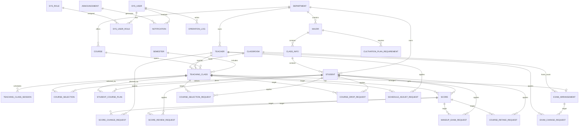

# 教学事务管理系统数据库大作业报告

## 一、系统概述

教学事务管理系统面向高校教学管理场景，覆盖管理员、教师和学生三类角色。系统主要解决课程基础数据维护、学期管理、教学班排课、学生选课、课表查询、成绩录入、考试安排、调课申请、退课审核、补选申请、通知公告等业务。

系统采用前后端分离架构：
- 前端：Vue 3、Element Plus、Pinia、Vite。
- 后端：Spring Boot、MyBatis。
- 数据库：MySQL，字符集为 `utf8mb4`。

数据库设计以教学班为核心，将“课程”“教师”“学生”“学期”“教室”“成绩”“考试”“申请审核”等业务对象连接起来。系统通过外键、唯一约束、触发器、存储过程和视图保证数据一致性与业务可追溯性。

## 二、概念设计

### 1. 主要实体

系统的主要实体包括：
- 院系：学校下属教学单位。
- 专业：归属于院系。
- 行政班：归属于专业。
- 学生：归属于院系、专业和行政班。
- 教师：归属于院系。
- 用户与角色：用于登录和权限区分。
- 学期：定义教学周期、选课时间、成绩提交时间和补考申请时间。
- 课程：定义课程基础信息、学分、学时、考核方式和成绩比例。
- 教室：提供上课和考试地点。
- 教学班：某门课程在某学期开设的具体班级，由教师授课并安排教室。
- 教学班上课时间：一个教学班的一次上课时间块，支持一门课多次上课和单双周排课。
- 选课记录：学生和教学班之间的选课关系。
- 学习计划与培养方案：记录学生课程计划和专业培养方案学分要求。
- 成绩：学生在某教学班中的成绩。
- 考试安排：教学班对应的考试时间和地点。
- 申请类实体：补选申请、退课申请、调课申请、成绩修改申请、成绩复核申请、考试修改申请、补考申请、重修申请等。
- 公告与通知：管理员发布公告，系统向具体用户投递通知。
- 操作日志：记录关键管理操作。

### 2. 主要业务关系

- 一个院系可以包含多个专业、多个教师和多门课程。
- 一个专业可以包含多个行政班，一个行政班可以包含多个学生。
- 一个学期可以包含多个教学班。
- 一门课程可以在多个学期开设为多个教学班。
- 一个教师可以教授多个教学班。
- 一个教学班可以有多个上课时间块。
- 一个学生可以选择多个教学班，一个教学班可以被多个学生选择。
- 一个学生在一个教学班中最多对应一条成绩记录。
- 一个教学班最多对应一条考试安排。
- 教师可以围绕教学班发起调课申请、考试修改申请和成绩修改申请。
- 学生可以发起补选、退课、成绩复核、补考等申请。
- 管理员负责维护基础数据、设置学期业务时间、审核申请和发布公告。

### 3. ER 图

## 三、逻辑设计

### 1. 表关系设计说明

系统数据库采用关系模型。基础数据表包括 `department`、`major`、`class_info`、`student`、`teacher`、`course`、`classroom`、`semester`。业务表包括 `teaching_class`、`teaching_class_session`、`course_selection`、`student_course_plan`、`cultivation_plan_requirement`、`score`、`exam_arrangement`。流程表包括各类申请表。支撑表包括用户、角色、公告、通知和操作日志。

主键设计以业务编号和自增编号结合：
- 学生、教师、课程、院系、专业、行政班、教室使用业务编号作为主键。
- 学期、教学班、选课、成绩、申请、考试、通知、日志等使用自增主键。

核心唯一约束：
- `course_selection` 对 `(student_id, teaching_class_id)` 建立唯一约束，避免重复选课。
- `score` 对 `(student_id, teaching_class_id)` 建立唯一约束，保证一名学生在一个教学班中只有一条成绩。
- `exam_arrangement` 对 `teaching_class_id` 建立唯一约束，保证一个教学班最多一条考试安排。
- `sys_user.username` 唯一，保证登录账号唯一。

### 2. 表结构设计

#### department 院系表

| 字段名 | 类型 | 长度/精度 | 约束 | 说明 |
|---|---:|---:|---|---|
| department_id | VARCHAR | 10 | PK | 院系编号 |
| department_name | VARCHAR | 50 | NOT NULL, UNIQUE | 院系名称 |
| office_address | VARCHAR | 100 | NULL | 办公地点 |
| contact_phone | VARCHAR | 20 | NULL | 联系电话 |

#### major 专业表

| 字段名 | 类型 | 长度/精度 | 约束 | 说明 |
|---|---:|---:|---|---|
| major_id | VARCHAR | 10 | PK | 专业编号 |
| major_name | VARCHAR | 50 | NOT NULL, UNIQUE | 专业名称 |
| department_id | VARCHAR | 10 | FK | 所属院系 |

#### class_info 行政班表

| 字段名 | 类型 | 长度/精度 | 约束 | 说明 |
|---|---:|---:|---|---|
| class_id | VARCHAR | 10 | PK | 班级编号 |
| class_name | VARCHAR | 50 | NOT NULL, UNIQUE | 班级名称 |
| grade_year | CHAR | 4 | NOT NULL | 年级 |
| major_id | VARCHAR | 10 | FK | 专业编号 |
| counselor_name | VARCHAR | 20 | NULL | 辅导员 |

#### student 学生表

| 字段名 | 类型 | 长度/精度 | 约束 | 说明 |
|---|---:|---:|---|---|
| student_id | VARCHAR | 12 | PK | 学号 |
| student_name | VARCHAR | 20 | NOT NULL | 姓名 |
| gender | CHAR | 1 | NOT NULL | 性别 |
| birth_date | DATE | - | NULL | 出生日期 |
| hometown | VARCHAR | 50 | NULL | 籍贯 |
| phone | VARCHAR | 20 | NULL | 手机号 |
| email | VARCHAR | 50 | NULL | 邮箱 |
| enrollment_year | CHAR | 4 | NOT NULL | 入学年份 |
| department_id | VARCHAR | 10 | FK | 院系编号 |
| major_id | VARCHAR | 10 | FK | 专业编号 |
| class_id | VARCHAR | 10 | FK | 班级编号 |
| status | VARCHAR | 20 | DEFAULT '正常' | 学籍状态 |

#### teacher 教师表

| 字段名 | 类型 | 长度/精度 | 约束 | 说明 |
|---|---:|---:|---|---|
| teacher_id | VARCHAR | 12 | PK | 工号 |
| teacher_name | VARCHAR | 20 | NOT NULL | 姓名 |
| gender | CHAR | 1 | NOT NULL | 性别 |
| birth_date | DATE | - | NULL | 出生日期 |
| title_name | VARCHAR | 20 | NOT NULL | 职称 |
| education | VARCHAR | 20 | NULL | 学历 |
| phone | VARCHAR | 20 | NULL | 手机号 |
| email | VARCHAR | 50 | NULL | 邮箱 |
| department_id | VARCHAR | 10 | FK | 所属院系 |
| status | VARCHAR | 20 | DEFAULT '在职' | 教师状态 |

#### sys_role 角色表

| 字段名 | 类型 | 长度/精度 | 约束 | 说明 |
|---|---:|---:|---|---|
| role_id | INT | - | PK, AUTO_INCREMENT | 角色编号 |
| role_code | VARCHAR | 30 | NOT NULL, UNIQUE | 角色编码 |
| role_name | VARCHAR | 30 | NOT NULL | 角色名称 |

#### sys_user 系统用户表

| 字段名 | 类型 | 长度/精度 | 约束 | 说明 |
|---|---:|---:|---|---|
| user_id | INT | - | PK, AUTO_INCREMENT | 用户编号 |
| username | VARCHAR | 30 | NOT NULL, UNIQUE | 登录账号 |
| password | VARCHAR | 100 | NOT NULL | 登录密码 |
| real_name | VARCHAR | 20 | NOT NULL | 真实姓名 |
| user_type | VARCHAR | 20 | NOT NULL | 用户类型 |
| ref_id | VARCHAR | 12 | NULL | 关联学生或教师编号 |
| is_enabled | TINYINT | - | DEFAULT 1 | 是否启用 |
| created_at | DATETIME | - | DEFAULT CURRENT_TIMESTAMP | 创建时间 |

#### sys_user_role 用户角色关联表

| 字段名 | 类型 | 长度/精度 | 约束 | 说明 |
|---|---:|---:|---|---|
| user_id | INT | - | PK, FK | 用户编号 |
| role_id | INT | - | PK, FK | 角色编号 |

#### semester 学期表

| 字段名 | 类型 | 长度/精度 | 约束 | 说明 |
|---|---:|---:|---|---|
| semester_id | INT | - | PK, AUTO_INCREMENT | 学期编号 |
| semester_name | VARCHAR | 30 | NOT NULL, UNIQUE | 学期名称 |
| school_year | VARCHAR | 20 | NOT NULL | 学年 |
| term_code | VARCHAR | 10 | NOT NULL | 学期代码 |
| start_date | DATE | - | NOT NULL | 开始日期 |
| end_date | DATE | - | NOT NULL | 结束日期 |
| course_select_start | DATETIME | - | NOT NULL | 选课开始时间 |
| course_select_end | DATETIME | - | NOT NULL | 选课结束时间 |
| course_selection_manual_mode | VARCHAR | 10 | DEFAULT 'AUTO' | 选课手动控制模式 |
| course_selection_manual_end | DATETIME | - | NULL | 手动开启截止时间 |
| score_submit_start | DATETIME | - | NULL | 成绩提交开始时间 |
| score_submit_end | DATETIME | - | NULL | 成绩提交结束时间 |
| makeup_request_start | DATETIME | - | NULL | 补考申请开始时间 |
| makeup_request_end | DATETIME | - | NULL | 补考申请结束时间 |
| is_current | TINYINT | - | DEFAULT 0 | 是否当前学期 |

#### course 课程表

| 字段名 | 类型 | 长度/精度 | 约束 | 说明 |
|---|---:|---:|---|---|
| course_id | VARCHAR | 12 | PK | 课程编号 |
| course_name | VARCHAR | 50 | NOT NULL, UNIQUE | 课程名称 |
| course_type | VARCHAR | 20 | NOT NULL | 课程类型 |
| credit | DECIMAL | 4,1 | NOT NULL | 学分 |
| total_hours | INT | - | NOT NULL | 总学时 |
| assessment_method | VARCHAR | 20 | DEFAULT '考试' | 考核方式 |
| usual_ratio | TINYINT | - | DEFAULT 40 | 平时成绩占比 |
| exam_ratio | TINYINT | - | DEFAULT 60 | 考试成绩占比 |
| department_id | VARCHAR | 10 | FK | 开课院系 |
| is_required | TINYINT | - | DEFAULT 1 | 是否必修 |
| description | VARCHAR | 200 | NULL | 课程说明 |

#### classroom 教室表

| 字段名 | 类型 | 长度/精度 | 约束 | 说明 |
|---|---:|---:|---|---|
| classroom_id | VARCHAR | 10 | PK | 教室编号 |
| building_name | VARCHAR | 30 | NOT NULL | 教学楼 |
| room_name | VARCHAR | 30 | NOT NULL | 教室名称 |
| capacity | INT | - | NOT NULL | 容量 |

#### teaching_class 教学班表

| 字段名 | 类型 | 长度/精度 | 约束 | 说明 |
|---|---:|---:|---|---|
| teaching_class_id | INT | - | PK, AUTO_INCREMENT | 教学班编号 |
| semester_id | INT | - | FK | 学期编号 |
| course_id | VARCHAR | 12 | FK | 课程编号 |
| teacher_id | VARCHAR | 12 | FK | 任课教师工号 |
| classroom_id | VARCHAR | 10 | FK, NULL | 教室编号 |
| course_start_date | DATE | - | NULL | 课程实际开课日期 |
| week_range | VARCHAR | 30 | NOT NULL | 周次范围 |
| is_retake_class | TINYINT | - | DEFAULT 0 | 是否重修班 |
| max_students | INT | - | DEFAULT 60 | 容量上限 |
| selected_count | INT | - | DEFAULT 0 | 已选人数 |
| status | VARCHAR | 20 | DEFAULT '未开始' | 教学班状态 |

#### teaching_class_session 教学班上课时间表

| 字段名 | 类型 | 长度/精度 | 约束 | 说明 |
|---|---:|---:|---|---|
| session_id | INT | - | PK, AUTO_INCREMENT | 上课时间编号 |
| teaching_class_id | INT | - | FK | 教学班编号 |
| week_day | TINYINT | - | NOT NULL | 星期几 |
| section_desc | VARCHAR | 20 | NOT NULL | 节次 |
| week_parity | VARCHAR | 10 | DEFAULT '全周' | 全周/单周/双周 |
| sort_order | INT | - | DEFAULT 1 | 排序 |

#### course_selection 选课表

| 字段名 | 类型 | 长度/精度 | 约束 | 说明 |
|---|---:|---:|---|---|
| selection_id | BIGINT | - | PK, AUTO_INCREMENT | 选课记录编号 |
| student_id | VARCHAR | 12 | FK | 学号 |
| teaching_class_id | INT | - | FK | 教学班编号 |
| selection_time | DATETIME | - | DEFAULT CURRENT_TIMESTAMP | 选课时间 |
| selection_status | VARCHAR | 20 | DEFAULT '已选' | 选课状态 |

#### score 成绩表

| 字段名 | 类型 | 长度/精度 | 约束 | 说明 |
|---|---:|---:|---|---|
| score_id | BIGINT | - | PK, AUTO_INCREMENT | 成绩编号 |
| student_id | VARCHAR | 12 | FK | 学号 |
| teaching_class_id | INT | - | FK | 教学班编号 |
| usual_score | DECIMAL | 5,2 | NULL | 平时成绩 |
| exam_score | DECIMAL | 5,2 | NULL | 考试成绩 |
| final_score | DECIMAL | 5,2 | NULL | 总评成绩 |
| gpa_point | DECIMAL | 3,1 | NULL | 绩点 |
| is_submitted | TINYINT | - | DEFAULT 0 | 是否提交 |
| entered_at | DATETIME | - | NULL | 录入时间 |

#### student_course_plan 学生课程计划表

| 字段名 | 类型 | 长度/精度 | 约束 | 说明 |
|---|---:|---:|---|---|
| plan_id | BIGINT | - | PK, AUTO_INCREMENT | 计划编号 |
| student_id | VARCHAR | 20 | NOT NULL | 学号 |
| teaching_class_id | INT | - | NOT NULL | 教学班编号 |
| created_at | DATETIME | - | DEFAULT CURRENT_TIMESTAMP | 创建时间 |

该表对 `(student_id, teaching_class_id)` 建立唯一约束，用于保存学生计划关注或准备选择的教学班。

#### cultivation_plan_requirement 培养方案要求表

| 字段名 | 类型 | 长度/精度 | 约束 | 说明 |
|---|---:|---:|---|---|
| requirement_id | BIGINT | - | PK, AUTO_INCREMENT | 要求编号 |
| enrollment_year | INT | - | NOT NULL | 入学年份 |
| major_id | VARCHAR | 20 | NOT NULL | 专业编号 |
| course_type | VARCHAR | 50 | NOT NULL | 课程类型 |
| required_credit | DECIMAL | 5,1 | DEFAULT 0 | 要求学分 |
| remark | VARCHAR | 255 | NULL | 备注 |
| created_at | DATETIME | - | DEFAULT CURRENT_TIMESTAMP | 创建时间 |
| updated_at | DATETIME | - | DEFAULT CURRENT_TIMESTAMP | 更新时间 |

该表对 `(enrollment_year, major_id, course_type)` 建立唯一约束，用于按年级、专业和课程类型定义毕业或培养方案要求。

#### exam_arrangement 考试安排表

| 字段名 | 类型 | 长度/精度 | 约束 | 说明 |
|---|---:|---:|---|---|
| exam_id | BIGINT | - | PK, AUTO_INCREMENT | 考试安排编号 |
| teaching_class_id | INT | - | FK, UNIQUE | 教学班编号 |
| exam_date | DATE | - | NOT NULL | 考试日期 |
| start_time | TIME | - | NOT NULL | 开始时间 |
| end_time | TIME | - | NOT NULL | 结束时间 |
| classroom_id | VARCHAR | 10 | FK, NULL | 考试教室 |
| exam_status | VARCHAR | 20 | DEFAULT '已排定' | 考试状态 |
| created_at | DATETIME | - | DEFAULT CURRENT_TIMESTAMP | 创建时间 |
| updated_at | DATETIME | - | NULL | 更新时间 |

#### 申请与审核表

| 表名 | 主键 | 主要字段 | 作用 |
|---|---|---|---|
| course_selection_request | request_id BIGINT | student_id、teaching_class_id、request_reason、request_status、review_comment、reviewed_by、reviewed_at、created_at | 学生补选申请 |
| course_drop_request | drop_request_id BIGINT | student_id、teaching_class_id、request_reason、teacher_status、admin_status、teacher_comment、admin_comment、created_at、updated_at | 学生退课申请，教师和管理员共同审核 |
| schedule_adjust_request | adjust_request_id BIGINT | teaching_class_id、teacher_id、original_week_day、requested_week_day、original_section_desc、requested_section_desc、request_status、review_comment | 教师调课申请 |
| score_change_request | score_change_request_id BIGINT | score_id、teacher_id、student_id、teaching_class_id、original_usual_score、original_exam_score、original_final_score、request_status | 教师成绩修改申请 |
| score_review_request | request_id BIGINT | student_id、score_id、request_reason、request_status、review_comment、reviewed_by、reviewed_at、created_at | 学生成绩复核申请 |
| exam_change_request | exam_change_request_id BIGINT | exam_id、teaching_class_id、teacher_id、original_exam_date、requested_exam_date、original_start_time、requested_start_time、request_status | 教师考试安排修改申请 |
| makeup_exam_request | request_id BIGINT | student_id、score_id、request_reason、requested_exam_time、confirmed_exam_time、teacher_status、admin_status、classroom_id、result_status | 学生补考申请，教师确认后由管理员安排 |
| course_retake_request | request_id BIGINT | student_id、score_id、request_reason、request_status、review_comment、reviewed_by、reviewed_at、created_at、updated_at | 学生重修申请 |

#### 公告、通知与日志表

| 表名 | 字段设计 | 作用 |
|---|---|---|
| announcement | announcement_id BIGINT、title VARCHAR(100)、content VARCHAR(1000)、target_scope VARCHAR(20)、target_department_id VARCHAR(10)、recipient_count INT、published_by INT、created_at DATETIME | 管理员发布公告 |
| notification | notification_id BIGINT、user_id INT、category VARCHAR(20)、title VARCHAR(100)、content VARCHAR(1000)、is_read TINYINT、ref_type VARCHAR(30)、ref_id VARCHAR(30)、announcement_id BIGINT、created_at DATETIME、read_at DATETIME | 用户站内通知 |
| operation_log | log_id BIGINT、user_id INT、operation_type VARCHAR(30)、operation_content VARCHAR(200)、operation_time DATETIME | 系统关键操作日志 |

### 3. 视图、触发器和存储过程

#### 视图

- `v_student_timetable`：联查选课、教学班、上课时间、学期、课程、教师、教室，提供学生课表查询。
- `v_student_score`：联查成绩、学生、教学班、学期、课程、教师，提供学生成绩查询和管理员成绩明细查询。

#### 触发器

- `trg_score_before_insert`：插入成绩前校验平时成绩和考试成绩是否在 0 到 100 之间；当两项成绩都存在时，根据课程平时成绩占比和考试成绩占比计算总评成绩与绩点。
- `trg_score_before_update`：更新成绩前执行同样的成绩范围校验和总评、绩点计算。

#### 存储过程

- `sp_select_course`：封装学生选课逻辑。过程内检查选课时间窗口、手动开启/关闭状态、是否重复选课、容量是否已满、上课时间是否冲突。如果学生曾退课同一教学班，则恢复原选课记录；否则新增选课记录，并同步更新教学班已选人数。

## 四、物理设计与功能详细信息

### 1. 基础数据管理

管理员维护院系、专业、行政班、学生、教师、课程、教室等基础数据。基础数据表之间使用外键约束，例如学生必须归属于已有院系、专业和行政班，课程必须归属于已有院系，教师必须归属于已有院系。

为了避免误删关键数据，系统在删除学生、教师、课程、教学班、学期等对象前会检查关联数据。有选课、成绩、考试、申请等关联数据时阻止删除。

### 2. 学期管理

学期表保存学期名称、学年、学期代码、开始日期、结束日期、选课时间、成绩提交时间、补考申请时间和当前学期标记。管理员创建学期时只需要填写开始日期，系统按 16 教学周加 2 考试周推导结束日期和考试周范围。

教师端和学生端都会展示当前学期。教师课表页按学期切换时，学期状态只描述学期本身：当前学期显示“当前”，历史学期显示“已结束”，未来学期显示“未开始”。

### 3. 课程与教学班管理

课程表保存课程编号、课程名称、课程类型、学分、总学时、考核方式和成绩比例。教学班表表示课程在某学期的具体开课实例，关联课程、教师、教室和学期。

上课时间从教学班主表拆分到 `teaching_class_session`，一门课可以有多个上课时间块。排课时按照学分生成对应节次，奇数学分课程可安排单周或双周课程。系统检查同一学期、同一教师、同一教室的时间冲突，单双周不相交时不判定为冲突。

### 4. 学生选课

学生选课由 `course_selection` 表记录。选课时调用 `sp_select_course` 存储过程，检查选课时间、容量、重复选课和课程时间冲突。若学生曾退选同一教学班，重新选课时恢复原记录并清理旧成绩，避免历史成绩影响重新学习。

选课状态保留为字段而不是删除记录，可以支持退课历史、重新加入和后续统计。

### 5. 教师授课管理

教师端通过教师工号查询本人教学班。课表页面以 `teaching_class` 和 `teaching_class_session` 生成周课表，展示课程名称、节次、周次、单双周、教室和选课人数。教师可按学期切换课表，并可导出 PDF。

教学班详情展示课程编号、课程类型、学分、考核方式、平时考试比例、开课院系、容量和学生名单。学生名单来源于 `course_selection` 中 `selection_status = '已选'` 的记录。

### 6. 成绩录入与成绩控制

成绩表保存平时成绩、考试成绩、总评成绩、绩点和提交状态。教师可以暂存成绩或正式提交成绩。正式提交时，后端校验当前时间是否处于学期成绩提交时间窗口内。

总评成绩和绩点由数据库触发器计算，避免前端和后端重复实现导致计算不一致。课程表中的 `usual_ratio` 和 `exam_ratio` 支持不同课程设置不同成绩比例。

已提交成绩默认只读。教师如需修改，必须发起成绩修改申请。管理员审核通过后，成绩退回未提交状态，教师重新修改并提交。

### 7. 调课申请

调课申请表保存原上课时间、原教室、申请后上课时间、申请后教室和申请原因。教师提交调课申请时，系统要求周次保持不变、节次跨度保持一致。目标教室必须在对应学期、星期、节次和单双周范围内空闲，同一教师在目标时间也不能有其它课程。

管理员审核通过后，系统更新教学班上课安排；审核驳回时保留原排课。教师可撤销本人待审核申请。

### 8. 考试安排与考试修改

考试安排表保存教学班对应的考试日期、开始时间、结束时间、考试教室和考试状态。一个教学班最多一条考试安排。

教师可查看当前学期本人课程考试安排，并提交考试时间或教室修改申请。申请时系统动态查询可用教室，排除同日期同时间段已被占用的教室，并检查同一教师是否已有其它考试。管理员审核通过后更新考试安排。

### 9. 退课、补选与复核申请

学习计划表用于学生提前规划课程，培养方案要求表用于按入学年份、专业和课程类型维护应修学分。学生端可以据此展示已修学分、缺口和课程规划。

补选申请用于学生在无法直接选课时申请加入教学班，管理员审核通过后写入或恢复选课记录。

退课申请采用教师和管理员两级审核。退课通过后，选课状态改为 `已退`，并清理对应成绩记录。

成绩复核申请由学生发起，管理员查看成绩和申请原因后给出审核结果。教师成绩修改申请则由教师发起，用于修改已提交成绩。

补考申请由学生基于不及格成绩发起，教师确认补考信息后，管理员安排教室和最终结果。重修申请用于学生申请重新学习未通过或需要重修的课程。

### 10. 通知公告与操作日志

管理员发布公告后，系统按投递范围写入通知表。通知表支持公告、审批结果和系统消息。用户可查看通知并标记已读。

操作日志表记录管理员关键操作，包括学期管理、考试安排、审核处理、公告发布等，便于回溯系统操作。

### 11. 权限与数据边界

系统通过 `sys_user`、`sys_role` 和 `sys_user_role` 区分管理员、教师、学生三类角色。教师端接口会根据登录用户关联的教师工号限制数据范围，保证教师只能查看和操作本人授课教学班。学生端接口根据登录用户关联的学号限制选课、课表和成绩数据。

## 五、体会

本次数据库设计的重点不是简单建表，而是把教学事务中的业务规则落实到数据结构和约束中。最核心的体会有以下几点。

第一，概念模型必须先理清业务主线。系统中很多功能都围绕教学班展开，例如选课、课表、成绩、考试、退课和调课。如果教学班和学期、课程、教师、教室之间的关系设计不清楚，后续功能会出现大量重复字段和不一致数据。

第二，逻辑设计需要兼顾规范化和业务查询效率。把上课时间拆分为 `teaching_class_session` 后，系统能支持一门课多个时间段，也能表达单双周；同时教学班主表保持简洁，避免在一张表中硬塞多个星期和节次字段。

第三，物理设计要让数据库承担一部分可靠性职责。成绩范围校验、总评成绩计算、绩点计算放到触发器中，选课核心流程放到存储过程中，可以减少前后端重复实现带来的误差，也让关键业务规则更稳定。

第四，状态字段和申请表是教学事务系统中非常重要的设计。退课不直接删除选课记录，成绩提交后不直接允许修改，而是通过状态和申请流程保留轨迹。这种设计虽然表更多，但数据可追溯性更好。

第五，前端展示状态必须和业务语义一致。例如教师课表中的“当前、已结束、未开始”应描述学期状态，而不是选课窗口状态。否则用户会误以为“已结束”表示学期结束。数据库字段和页面展示之间需要明确区分业务概念。

通过本次设计，我对 ER 建模、关系表拆分、主外键约束、唯一约束、触发器、存储过程、视图以及业务状态流转有了更完整的理解，也认识到数据库设计质量会直接影响后端代码复杂度和前端用户体验。
