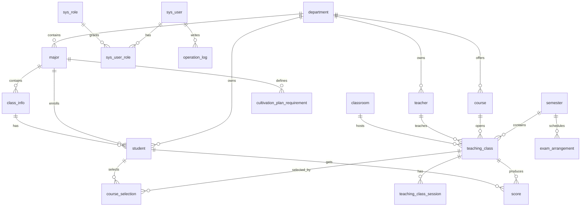
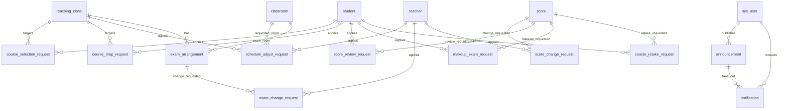
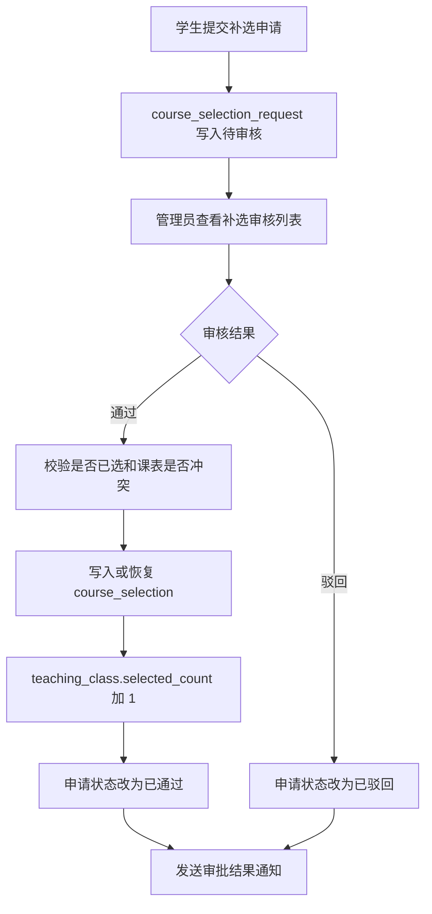

# 教学事务管理系统管理员端数据库设计与实现报告

## 一、系统概述

教学事务管理系统采用 B/S 架构，面向系统管理员、教师、学生三类用户。管理员端是系统的基础数据维护中心、教学运行控制中心和业务审批中心，负责维护学生、教师、课程、学期、教学班、考试安排等基础数据，并对补选、退课、调课、考试修改、成绩修改、成绩复核、补考和重修等申请进行审核处理。

系统后端使用 Spring Boot、MyBatis 和 MySQL，前端使用 Vue 3、Vite、Element Plus。管理员端页面位于 `frontend/src/views/admin`，接口封装位于 `frontend/src/api/admin.js`，后端控制器、业务层和数据访问层分别位于 `com.school.admin.controller`、`com.school.admin.service` 和 `com.school.admin.mapper`。

管理员端主要功能包括：

- 基础数据管理：学生、教师、课程、学期、教学班、考试、培养方案。
- 教学运行控制：选课时间设置、手动开启/强制关闭选课、成绩提交时间设置、补考申请时间设置。
- 审批管理：补选、退课、调课、考试修改、成绩修改、成绩复核、补考和重修审核。
- 统计分析：选课人数统计、容量使用率、成绩分布、教学运行概览。
- 运行辅助：冲突检测、数据导入导出、公告发布、站内通知和操作日志。

## 二、需求分析

### 1. 管理员用户需求

管理员需要在系统中完成全校教学事务的集中维护和监管。主要需求如下：

- 能够维护学生、教师、课程等基础资料，并保证新增学生和教师时同步生成登录账号。
- 能够按学期维护教学安排，创建当前学期、设置选课时间、结转历史教学班。
- 能够创建教学班，指定课程、任课教师、教室、容量、开课日期和重修班标识。
- 能够查看教学班选课人数、容量使用率和学生名单。
- 能够审核学生补选和退课申请，审核通过后自动写入选课关系或执行退课。
- 能够审核教师调课、考试修改和成绩修改申请，审核通过后同步更新教学班、考试或成绩状态。
- 能够审核学生成绩复核、补考和重修申请，并保留审核意见。
- 能够发布公告，并按全体、学生、教师或院系范围投递到用户消息中心。
- 能够查看操作日志，追踪关键维护和审批行为。

### 2. 数据管理需求

管理员端涉及的数据范围较广，既包括基础信息，也包括教学过程数据和审批流数据。数据库设计需要满足以下要求：

- 基础实体之间关系清晰，院系、专业、班级、学生、教师、课程、教学班之间能够通过外键或业务主键关联。
- 多对多关系需要拆分为中间表，例如学生与教学班之间通过 `course_selection` 表建立选课关系。
- 审批流程需要独立申请表保存过程数据，不能只依赖最终业务表状态。
- 成绩总评和绩点计算规则应统一放在数据库触发器中，避免前端、后端重复计算造成不一致。
- 关键业务需要保留日志和通知，方便后续追溯。

## 三、概念设计

### 1. 实体识别

根据管理员端业务，可以抽象出以下核心实体：

- 组织类实体：院系、专业、行政班。
- 人员与权限类实体：学生、教师、系统用户、角色、用户角色。
- 教学运行类实体：学期、课程、教室、教学班、教学班上课时间、选课记录、成绩。
- 申请审批类实体：补选申请、退课申请、调课申请、成绩修改申请、成绩复核申请、补考申请、重修申请、考试修改申请。
- 考试与学业类实体：考试安排、培养方案要求、学生选课计划。
- 辅助类实体：公告、站内通知、操作日志。

### 2. 基础数据与教学安排 E-R 图

### 3. 审批、成绩、考试与通知 E-R 图

### 4. 主要联系说明

| 联系 | 类型 | 说明 |
| --- | --- | --- |
| 院系 - 专业 | 1:N | 一个院系下设多个专业，一个专业只属于一个院系。 |
| 专业 - 行政班 | 1:N | 一个专业下可有多个行政班。 |
| 行政班 - 学生 | 1:N | 一个行政班包含多个学生，一个学生归属一个行政班。 |
| 学期 - 教学班 | 1:N | 一个学期可开设多个教学班。 |
| 课程 - 教学班 | 1:N | 一门课程可在不同学期或不同教师下开设多个教学班。 |
| 教师 - 教学班 | 1:N | 一个教师可教授多个教学班。 |
| 教室 - 教学班 | 1:N | 一个教室可在不同时间承载多个教学班。 |
| 教学班 - 上课时间 | 1:N | 一门教学班可对应多段上课时间，支持多节课和单双周。 |
| 学生 - 教学班 | M:N | 通过 `course_selection` 拆分为两组 1:N。 |
| 教学班 - 成绩 | 1:N | 一个教学班对应多个学生成绩。 |
| 申请表 - 管理员 | N:1 | 多类申请由管理员审核，审核人记录为 `sys_user.user_id`。 |
| 公告 - 通知 | 1:N | 管理员发布一条公告后，系统按范围生成多条通知。 |

## 四、逻辑设计

### 1. 关系模式设计

管理员端数据库采用关系模型，将业务对象拆分为基础数据表、教学运行表、审批流程表和辅助功能表。核心关系模式如下：

- 院系：`department(department_id, department_name, office_address, contact_phone)`
- 专业：`major(major_id, major_name, department_id)`
- 行政班：`class_info(class_id, class_name, grade_year, major_id, counselor_name)`
- 学生：`student(student_id, student_name, gender, birth_date, hometown, phone, email, enrollment_year, department_id, major_id, class_id, status)`
- 教师：`teacher(teacher_id, teacher_name, gender, birth_date, title_name, education, phone, email, department_id, status)`
- 用户：`sys_user(user_id, username, password, real_name, user_type, ref_id, is_enabled, created_at)`
- 学期：`semester(semester_id, semester_name, school_year, term_code, start_date, end_date, course_select_start, course_select_end, course_selection_manual_mode, course_selection_manual_end, score_submit_start, score_submit_end, makeup_request_start, makeup_request_end, is_current)`
- 课程：`course(course_id, course_name, course_type, credit, total_hours, assessment_method, usual_ratio, exam_ratio, department_id, is_required, description)`
- 教学班：`teaching_class(teaching_class_id, semester_id, course_id, teacher_id, classroom_id, course_start_date, week_range, is_retake_class, max_students, selected_count, status)`
- 上课时间：`teaching_class_session(session_id, teaching_class_id, week_day, section_desc, week_parity, sort_order)`
- 选课记录：`course_selection(selection_id, student_id, teaching_class_id, selection_time, selection_status)`
- 成绩：`score(score_id, student_id, teaching_class_id, usual_score, exam_score, final_score, gpa_point, is_submitted, entered_at)`
- 各类申请表：补选、退课、调课、考试修改、成绩修改、成绩复核、补考、重修。
- 辅助表：考试安排、培养方案、公告、通知、操作日志。

### 2. 表结构设计

字段类型以 MySQL DDL 为准。`PK` 表示主键，`FK` 表示外键，`UK` 表示唯一约束，`IDX` 表示普通索引。部分扩展表脚本中未显式定义外键，但在业务逻辑上仍按照对应主表字段关联。

#### 2.1 基础组织与账号表

| 表名 | 字段名、类型与长度 | 主键与约束 | 说明 |
| --- | --- | --- | --- |
| `department` | `department_id` VARCHAR(10)，`department_name` VARCHAR(50)，`office_address` VARCHAR(100)，`contact_phone` VARCHAR(20) | PK: `department_id`；UK: `department_name` | 院系表，保存学院/系部信息。 |
| `major` | `major_id` VARCHAR(10)，`major_name` VARCHAR(50)，`department_id` VARCHAR(10) | PK: `major_id`；UK: `major_name`；FK: `department_id` | 专业表，关联所属院系。 |
| `class_info` | `class_id` VARCHAR(10)，`class_name` VARCHAR(50)，`grade_year` CHAR(4)，`major_id` VARCHAR(10)，`counselor_name` VARCHAR(20) | PK: `class_id`；UK: `class_name`；FK: `major_id` | 行政班表。 |
| `student` | `student_id` VARCHAR(12)，`student_name` VARCHAR(20)，`gender` CHAR(1)，`birth_date` DATE，`hometown` VARCHAR(50)，`phone` VARCHAR(20)，`email` VARCHAR(50)，`enrollment_year` CHAR(4)，`department_id` VARCHAR(10)，`major_id` VARCHAR(10)，`class_id` VARCHAR(10)，`status` VARCHAR(20) | PK: `student_id`；FK: `department_id`、`major_id`、`class_id` | 学生基础信息表。 |
| `teacher` | `teacher_id` VARCHAR(12)，`teacher_name` VARCHAR(20)，`gender` CHAR(1)，`birth_date` DATE，`title_name` VARCHAR(20)，`education` VARCHAR(20)，`phone` VARCHAR(20)，`email` VARCHAR(50)，`department_id` VARCHAR(10)，`status` VARCHAR(20) | PK: `teacher_id`；FK: `department_id` | 教师基础信息表。 |
| `sys_role` | `role_id` INT，`role_code` VARCHAR(30)，`role_name` VARCHAR(30) | PK: `role_id`；UK: `role_code` | 角色表，包含 ADMIN、TEACHER、STUDENT。 |
| `sys_user` | `user_id` INT，`username` VARCHAR(30)，`password` VARCHAR(100)，`real_name` VARCHAR(20)，`user_type` VARCHAR(20)，`ref_id` VARCHAR(12)，`is_enabled` TINYINT，`created_at` DATETIME | PK: `user_id`；UK: `username` | 登录用户表，学生/教师通过 `ref_id` 关联业务身份。 |
| `sys_user_role` | `user_id` INT，`role_id` INT | PK: `user_id, role_id`；FK: `user_id`、`role_id` | 用户角色关联表。 |

#### 2.2 教学运行表

| 表名 | 字段名、类型与长度 | 主键与约束 | 说明 |
| --- | --- | --- | --- |
| `semester` | `semester_id` INT，`semester_name` VARCHAR(30)，`school_year` VARCHAR(20)，`term_code` VARCHAR(10)，`start_date` DATE，`end_date` DATE，`course_select_start` DATETIME，`course_select_end` DATETIME，`course_selection_manual_mode` VARCHAR(10)，`course_selection_manual_end` DATETIME，`score_submit_start` DATETIME，`score_submit_end` DATETIME，`makeup_request_start` DATETIME，`makeup_request_end` DATETIME，`is_current` TINYINT | PK: `semester_id`；UK: `semester_name` | 学期表，集中保存选课、成绩提交、补考申请等时间窗口。 |
| `course` | `course_id` VARCHAR(12)，`course_name` VARCHAR(50)，`course_type` VARCHAR(20)，`credit` DECIMAL(4,1)，`total_hours` INT，`assessment_method` VARCHAR(20)，`usual_ratio` TINYINT，`exam_ratio` TINYINT，`department_id` VARCHAR(10)，`is_required` TINYINT，`description` VARCHAR(200) | PK: `course_id`；UK: `course_name`；FK: `department_id` | 课程表，保存课程学分、学时、考核方式和成绩占比。 |
| `classroom` | `classroom_id` VARCHAR(10)，`building_name` VARCHAR(30)，`room_name` VARCHAR(30)，`capacity` INT | PK: `classroom_id` | 教室表。 |
| `teaching_class` | `teaching_class_id` INT，`semester_id` INT，`course_id` VARCHAR(12)，`teacher_id` VARCHAR(12)，`classroom_id` VARCHAR(10)，`course_start_date` DATE，`week_range` VARCHAR(30)，`is_retake_class` TINYINT，`max_students` INT，`selected_count` INT，`status` VARCHAR(20) | PK: `teaching_class_id`；FK: `semester_id`、`course_id`、`teacher_id`、`classroom_id` | 教学班表，是管理员排课、学生选课、教师授课的核心表。 |
| `teaching_class_session` | `session_id` INT，`teaching_class_id` INT，`week_day` TINYINT，`section_desc` VARCHAR(20)，`week_parity` VARCHAR(10)，`sort_order` INT | PK: `session_id`；FK: `teaching_class_id`；IDX: `teaching_class_id`、`week_day, section_desc` | 教学班上课时间表，一行表示一段上课时间。 |
| `course_selection` | `selection_id` BIGINT，`student_id` VARCHAR(12)，`teaching_class_id` INT，`selection_time` DATETIME，`selection_status` VARCHAR(20) | PK: `selection_id`；UK: `student_id, teaching_class_id`；FK: `student_id`、`teaching_class_id` | 选课记录表，保留已选和已退状态。 |
| `student_course_plan` | `plan_id` BIGINT，`student_id` VARCHAR(20)，`teaching_class_id` INT，`created_at` DATETIME | PK: `plan_id`；UK: `student_id, teaching_class_id`；IDX: `student_id`、`teaching_class_id` | 学生选课计划表。 |
| `score` | `score_id` BIGINT，`student_id` VARCHAR(12)，`teaching_class_id` INT，`usual_score` DECIMAL(5,2)，`exam_score` DECIMAL(5,2)，`final_score` DECIMAL(5,2)，`gpa_point` DECIMAL(3,1)，`is_submitted` TINYINT，`entered_at` DATETIME | PK: `score_id`；UK: `student_id, teaching_class_id`；FK: `student_id`、`teaching_class_id` | 成绩表，总评成绩和绩点由触发器计算。 |
| `cultivation_plan_requirement` | `requirement_id` BIGINT，`enrollment_year` INT，`major_id` VARCHAR(20)，`course_type` VARCHAR(50)，`required_credit` DECIMAL(5,1)，`remark` VARCHAR(255)，`created_at` DATETIME，`updated_at` DATETIME | PK: `requirement_id`；UK: `enrollment_year, major_id, course_type`；IDX: `major_id, enrollment_year` | 培养方案要求表，用于学业进度统计。 |

#### 2.3 申请审批表

| 表名 | 字段名、类型与长度 | 主键与约束 | 说明 |
| --- | --- | --- | --- |
| `course_selection_request` | `request_id` BIGINT，`student_id` VARCHAR(12)，`teaching_class_id` INT，`request_reason` VARCHAR(200)，`request_status` VARCHAR(20)，`review_comment` VARCHAR(200)，`reviewed_by` INT，`reviewed_at` DATETIME，`created_at` DATETIME | PK: `request_id`；FK: `student_id`、`teaching_class_id`、`reviewed_by` | 补选申请表。 |
| `course_drop_request` | `drop_request_id` BIGINT，`student_id` VARCHAR(12)，`teaching_class_id` INT，`request_reason` VARCHAR(200)，`request_status` VARCHAR(20)，`teacher_status` VARCHAR(20)，`teacher_comment` VARCHAR(200)，`teacher_reviewed_by` VARCHAR(12)，`teacher_reviewed_at` DATETIME，`admin_status` VARCHAR(20)，`admin_comment` VARCHAR(200)，`admin_reviewed_by` INT，`admin_reviewed_at` DATETIME，`created_at` DATETIME，`updated_at` DATETIME | PK: `drop_request_id`；FK: `student_id`、`teaching_class_id`、`teacher_reviewed_by`、`admin_reviewed_by` | 退课申请表，教师和管理员均通过后执行退课。 |
| `schedule_adjust_request` | `adjust_request_id` BIGINT，`teaching_class_id` INT，`session_id` INT，`teacher_id` VARCHAR(12)，`original_week_day` TINYINT，`original_section_desc` VARCHAR(20)，`original_week_range` VARCHAR(30)，`original_classroom_id` VARCHAR(10)，`requested_week_day` TINYINT，`requested_section_desc` VARCHAR(20)，`requested_week_range` VARCHAR(30)，`requested_classroom_id` VARCHAR(10)，`request_reason` VARCHAR(200)，`request_status` VARCHAR(20)，`review_comment` VARCHAR(200)，`reviewed_by` INT，`reviewed_at` DATETIME，`created_at` DATETIME，`updated_at` DATETIME | PK: `adjust_request_id`；FK: `teaching_class_id`、`teacher_id`、`original_classroom_id`、`requested_classroom_id`、`reviewed_by` | 调课申请表，保存原安排和申请后安排。 |
| `score_change_request` | `score_change_request_id` BIGINT，`score_id` BIGINT，`teacher_id` VARCHAR(12)，`student_id` VARCHAR(12)，`teaching_class_id` INT，`original_usual_score` DECIMAL(5,2)，`original_exam_score` DECIMAL(5,2)，`original_final_score` DECIMAL(5,2)，`original_gpa_point` DECIMAL(3,1)，`request_reason` VARCHAR(200)，`request_status` VARCHAR(20)，`review_comment` VARCHAR(200)，`reviewed_by` INT，`reviewed_at` DATETIME，`created_at` DATETIME，`updated_at` DATETIME | PK: `score_change_request_id`；FK: `score_id`、`teacher_id`、`student_id`、`teaching_class_id`、`reviewed_by` | 成绩修改申请表，保存原成绩快照。 |
| `score_review_request` | `request_id` BIGINT，`student_id` VARCHAR(12)，`score_id` BIGINT，`request_reason` VARCHAR(200)，`request_status` VARCHAR(20)，`review_comment` VARCHAR(200)，`reviewed_by` INT，`reviewed_at` DATETIME，`created_at` DATETIME | PK: `request_id`；FK: `student_id`、`score_id`、`reviewed_by`；IDX: `student_id`、`score_id`、`request_status` | 成绩复核申请表。 |
| `makeup_exam_request` | `request_id` BIGINT，`student_id` VARCHAR(20)，`score_id` BIGINT，`request_reason` VARCHAR(500)，`requested_exam_time` DATETIME，`confirmed_exam_time` DATETIME，`request_status` VARCHAR(20)，`teacher_status` VARCHAR(20)，`teacher_comment` VARCHAR(500)，`teacher_reviewed_by` VARCHAR(20)，`teacher_reviewed_at` DATETIME，`admin_status` VARCHAR(20)，`admin_comment` VARCHAR(500)，`admin_reviewed_by` INT，`admin_reviewed_at` DATETIME，`classroom_id` VARCHAR(20)，`result_status` VARCHAR(20)，`review_comment` VARCHAR(500)，`reviewed_by` INT，`reviewed_at` DATETIME，`created_at` DATETIME，`updated_at` DATETIME | PK: `request_id`；IDX: `student_id`、`score_id`、`request_status`、`teacher_status`、`admin_status`、`classroom_id, confirmed_exam_time` | 补考申请表，包含教师确认、管理员排教室和补考结果登记。 |
| `course_retake_request` | `request_id` BIGINT，`student_id` VARCHAR(20)，`score_id` BIGINT，`request_reason` VARCHAR(500)，`request_status` VARCHAR(20)，`review_comment` VARCHAR(500)，`reviewed_by` INT，`reviewed_at` DATETIME，`created_at` DATETIME，`updated_at` DATETIME | PK: `request_id`；IDX: `student_id`、`score_id`、`request_status` | 重修申请表。 |

#### 2.4 考试、通知与日志表

| 表名 | 字段名、类型与长度 | 主键与约束 | 说明 |
| --- | --- | --- | --- |
| `exam_arrangement` | `exam_id` BIGINT，`teaching_class_id` INT，`exam_date` DATE，`start_time` TIME，`end_time` TIME，`classroom_id` VARCHAR(10)，`exam_status` VARCHAR(20)，`created_at` DATETIME，`updated_at` DATETIME | PK: `exam_id`；UK: `teaching_class_id`；FK: `teaching_class_id`、`classroom_id` | 考试安排表，一个教学班最多一条考试安排。 |
| `exam_change_request` | `exam_change_request_id` BIGINT，`exam_id` BIGINT，`teaching_class_id` INT，`teacher_id` VARCHAR(12)，`original_exam_date` DATE，`original_start_time` TIME，`original_end_time` TIME，`original_classroom_id` VARCHAR(10)，`requested_exam_date` DATE，`requested_start_time` TIME，`requested_end_time` TIME，`requested_classroom_id` VARCHAR(10)，`request_reason` VARCHAR(200)，`request_status` VARCHAR(20)，`review_comment` VARCHAR(200)，`reviewed_by` INT，`reviewed_at` DATETIME，`created_at` DATETIME，`updated_at` DATETIME | PK: `exam_change_request_id`；FK: `exam_id`、`teaching_class_id`、`teacher_id`、`original_classroom_id`、`requested_classroom_id`、`reviewed_by`；IDX: `exam_id`、`teacher_id`、`request_status` | 考试修改申请表。 |
| `announcement` | `announcement_id` BIGINT，`title` VARCHAR(100)，`content` VARCHAR(1000)，`target_scope` VARCHAR(20)，`target_department_id` VARCHAR(10)，`recipient_count` INT，`published_by` INT，`created_at` DATETIME | PK: `announcement_id`；FK: `published_by`；IDX: `created_at` | 公告主表，保存管理员发布记录。 |
| `notification` | `notification_id` BIGINT，`user_id` INT，`category` VARCHAR(20)，`title` VARCHAR(100)，`content` VARCHAR(1000)，`is_read` TINYINT，`ref_type` VARCHAR(30)，`ref_id` VARCHAR(30)，`announcement_id` BIGINT，`created_at` DATETIME，`read_at` DATETIME | PK: `notification_id`；FK: `user_id`；IDX: `user_id, is_read`、`created_at` | 站内通知表，保存审批结果和公告投递结果。 |
| `operation_log` | `log_id` BIGINT，`user_id` INT，`operation_type` VARCHAR(30)，`operation_content` VARCHAR(200)，`operation_time` DATETIME | PK: `log_id`；FK: `user_id` | 操作日志表。 |

### 3. 视图、触发器与存储过程

| 类型 | 名称 | 作用 |
| --- | --- | --- |
| 视图 | `v_student_timetable` | 汇总学生已选课程、教学班、上课时间、教师和教室，用于课表查询。 |
| 视图 | `v_student_score` | 汇总成绩、课程、学期、教师和等级，用于学生成绩查询和管理员成绩明细查看。 |
| 触发器 | `trg_score_before_insert` | 插入成绩前校验分数范围，并按课程成绩占比计算总评成绩和绩点。 |
| 触发器 | `trg_score_before_update` | 更新成绩前重新计算总评成绩和绩点。 |
| 触发器 | `trg_course_selection_before_drop_update` | 退课状态变更前校验是否超过开课一周或三周规则。 |
| 触发器 | `trg_course_selection_after_drop_update` | 退课后删除对应成绩，并减少教学班已选人数。 |
| 触发器 | `trg_course_drop_request_before_insert` | 提交退课申请前校验学生是否已选课、是否处于可申请退课时间。 |
| 存储过程 | `sp_select_course` | 封装学生选课逻辑，校验选课时间、容量、重复选课和时间冲突。 |

## 五、物理设计与功能实现

### 1. 数据库物理设计

系统数据库使用 MySQL，表统一采用 InnoDB 存储引擎和 `utf8mb4` 字符集。InnoDB 支持事务和外键，适合选课、退课、审批等需要一致性的业务场景。

物理设计要点如下：

- 主键设计：基础编号类字段使用业务主键，例如 `student_id`、`teacher_id`、`course_id`；流程记录类表使用自增主键，例如 `request_id`、`score_id`、`exam_id`。
- 唯一约束：`course_selection` 对 `student_id, teaching_class_id` 建唯一约束，防止同一学生重复选同一教学班；`score` 对 `student_id, teaching_class_id` 建唯一约束，保证一名学生在一个教学班只有一条成绩。
- 外键约束：基础表和核心业务表之间建立外键，如学生关联院系、专业、班级，教学班关联学期、课程、教师和教室。
- 索引设计：对申请状态、学生编号、成绩编号、考试申请编号等常用查询条件建立索引，提高审批列表和统计查询效率。
- 状态字段设计：申请表统一使用 `request_status`，涉及多方审核时增加 `teacher_status`、`admin_status`，便于表达流程中间状态。
- 触发器设计：成绩计算和退课规则放在数据库层，保证即使不同接口修改数据，也能保持一致。
- 存储过程设计：选课流程封装为 `sp_select_course`，集中处理容量、时间、冲突和退课恢复等规则。

### 2. 管理员端模块设计

| 模块 | 页面/入口 | 主要接口 | 关键数据表 | 功能说明 |
| --- | --- | --- | --- | --- |
| 学生管理 | `/admin/students` | `GET/POST/PUT/DELETE /api/admin/students`，`POST /api/admin/students/import` | `student`、`sys_user`、`sys_user_role` | 查询、新增、编辑、删除学生；新增或批量导入时生成默认登录账号。 |
| 教师管理 | `/admin/teachers` | `GET/POST/PUT/DELETE /api/admin/teachers`，`POST /api/admin/teachers/import` | `teacher`、`sys_user`、`sys_user_role` | 维护教师资料；批量导入教师并同步账号。 |
| 课程管理 | `/admin/courses` | `GET/POST/PUT/DELETE /api/admin/courses` | `course`、`department` | 维护课程编号、名称、类型、学分、学时、考核方式和平时/考试成绩占比。 |
| 学期管理 | `/admin/semesters` | `GET /api/admin/semester-management`，`POST/PUT/DELETE /api/admin/semesters`，`PUT /api/admin/semesters/{id}/current` | `semester`、`teaching_class`、`teaching_class_session` | 选择学期开始日期后自动推导学期名称、教学周、考试周和选课时间；支持设置当前学期和结转教学班。 |
| 教学班管理 | `/admin/teaching-classes` | `GET/POST/PUT/DELETE /api/admin/teaching-classes`，`GET /api/admin/teaching-classes/{id}/students` | `teaching_class`、`teaching_class_session`、`course_selection` | 新增教学班、指定任课教师和教室、设置容量和重修班；按学分自动生成上课时间；查看已选学生名单。 |
| 选课与成绩设置 | `/admin/statistics` | `GET/PUT /api/admin/course-selection-setting`，`GET/PUT /api/admin/score-submit-setting` | `semester` | 设置选课起止时间、手动开启或强制关闭选课、设置成绩提交窗口和补考申请窗口。 |
| 考试管理 | `/admin/exams` | `GET /api/admin/exams`，`POST /api/admin/exams/generate`，`PUT/DELETE /api/admin/exams/{id}` | `exam_arrangement`、`teaching_class`、`classroom` | 为当前学期自动生成考试安排，支持修改考试时间、地点和删除考试。 |
| 审批看板 | `/admin/workflow-board` | 多类申请查询接口 | 多类申请表 | 汇总补选、退课、调课、考试修改、成绩修改、成绩复核、补考、重修申请，显示待处理数量和处理入口。 |
| 申请审核 | 审核管理菜单 | `PUT /api/admin/*/review` | 各类申请表、业务表、`notification` | 审核通过或驳回申请；通过时同步更新选课、教学班、成绩或考试安排；发送站内通知。 |
| 统计分析 | `/admin/statistics`、`/admin/score-analysis` | `GET /api/admin/statistics/*` | `course_selection`、`score`、`teaching_class` | 查看选课人数、容量使用率、已提交成绩和成绩分布。 |
| 冲突检测 | `/admin/conflict-check` | 复用教学班、考试和选项接口 | `teaching_class`、`teaching_class_session`、`exam_arrangement` | 检测教师时间冲突、教室占用冲突、容量异常、考试教室冲突等，并提供处理入口。 |
| 数据交换 | `/admin/data-exchange` | 数据查询接口和 CSV 导入接口 | 基础表、统计表、日志表 | 导出学生、教师、课程、教学班、考试、选课统计、培养方案和日志；导入学生、教师、培养方案。 |
| 公告通知 | `/admin/announcements` | `POST/GET /api/admin/announcements` | `announcement`、`notification`、`sys_user` | 管理员按全体、学生、教师或院系范围发布公告，并投递到消息中心。 |
| 操作日志 | `/admin/operation-logs` | `GET /api/admin/operation-logs`，`GET /api/admin/operation-logs/types` | `operation_log`、`sys_user` | 查询管理员增删改和审批操作，支持关键词、类型和分页过滤。 |

### 3. 关键业务流程

#### 3.1 补选审核流程

#### 3.2 退课审核流程

退课申请需要教师和管理员共同处理。学生在开课后一周至三周内提交退课申请，教师端先审核课程层面的可退性，管理员端再进行最终审核。两方都通过后，系统将 `course_selection.selection_status` 更新为 `已退`，触发器自动删除该教学班下对应学生的成绩，并减少教学班已选人数。若任一方驳回，退课申请结束并保留审核意见。

#### 3.3 调课和考试修改流程

教师提交调课或考试修改申请时，申请表会保存原安排和申请后的目标安排。管理员审核通过前，系统再次检查教室占用和教师时间冲突。通过后：

- 调课申请同步更新 `teaching_class_session` 或教学班相关安排。
- 考试修改申请同步更新 `exam_arrangement`。
- 申请表写入审核人、审核时间和审核意见。
- 系统向申请教师发送站内通知。

#### 3.4 成绩管理流程

教师录入成绩后，数据库触发器根据 `course.usual_ratio` 和 `course.exam_ratio` 计算总评成绩，并按照绩点规则生成 `gpa_point`。成绩提交后默认只读。若教师需要修改，需提交成绩修改申请，管理员审核通过后将成绩退回为未提交状态；若学生对成绩有异议，可提交成绩复核申请，管理员审核后保存处理意见。

### 4. 管理员端实现结构

后端采用 Controller、Service、Mapper 三层结构：

- `AdminController`：暴露 `/api/admin` 下的管理员接口，接收前端请求。
- `AdminService`：处理业务规则、事务控制、审核流转和通知发送。
- `AdminMapper`：使用 MyBatis 注解 SQL 完成数据库查询和更新。
- `OperationLogAspect`：拦截带有 `@OperationLog` 的方法，在操作成功后写入 `operation_log`。
- `NotificationService`：负责审批结果通知和公告投递。

前端采用 Vue 组件化实现：

- 每个管理员菜单对应一个 Vue 页面，例如 `AdminStudentView.vue`、`AdminTeachingClassView.vue`、`AdminWorkflowBoardView.vue`。
- API 统一封装在 `admin.js` 中，页面不直接拼接后端路径。
- 表格页面普遍支持筛选、排序、分页、弹窗编辑和状态标签展示。
- 数据导出使用前端 CSV 生成工具，导入通过 `FormData` 上传 CSV 文件。

## 六、系统特点与不足

### 1. 系统特点

- 管理员端覆盖面较完整，既包含基础维护，也包含选课、成绩、考试和审批流程。
- 数据表关系清晰，教学班作为课程、教师、学期、教室、学生选课和成绩之间的核心连接点。
- 申请类业务独立建表，能够完整保存申请原因、审核结果、审核意见、审核人和时间。
- 通过触发器和存储过程实现关键规则，减少前端和后端重复判断。
- 操作日志和站内通知增强了系统的可追溯性和业务闭环。

### 2. 存在不足

- 部分扩展表主要依赖业务层保证关联关系，后续可以补充更完整的外键约束。
- 管理员端部分列表目前以客户端分页为主，数据量增大后应改为后端分页查询。
- 冲突检测主要在前端汇总数据后判断，后续可将核心检测规则下沉到后端，便于统一复用。
- 权限控制已经按角色区分页面和接口，但还可以继续细化到按钮级或数据级权限。
- CSV 导入已具备基础校验，后续可以增加 Excel 模板、预览确认和错误行下载。

## 七、课程设计体会

通过本次数据库课程设计，我对“数据库不是简单存数据，而是业务规则和数据关系的基础”有了更直接的理解。管理员端涉及学生、教师、课程、学期、教学班、成绩和审批等大量实体，如果前期没有把实体关系和状态流转设计清楚，后续功能很容易出现重复数据、状态不一致或无法追溯的问题。

在概念设计阶段，最重要的是找准核心实体。本系统中教学班是连接课程、教师、学期、教室、选课和成绩的中心实体，很多功能看似不同，本质上都围绕教学班展开。明确这一点后，后续的选课、课表、考试、成绩和调课设计就更容易统一。

在逻辑设计阶段，我体会到关系表拆分的重要性。学生和教学班是多对多关系，如果直接在学生表或教学班表中保存选课信息，会导致结构混乱；拆分出 `course_selection` 后，不仅能表达已选和已退状态，也能支持容量统计、成绩关联和退课历史保留。

在物理设计阶段，索引、约束、触发器和事务同样重要。例如成绩总评和绩点由数据库触发器统一计算，可以避免多个端分别计算造成误差；退课和补选审核需要事务保证，防止只更新了一部分数据导致人数、成绩和选课记录不一致。

管理员端的实现也让我认识到审批流设计不能只关注“通过/驳回”两个结果，还要记录申请人、申请原因、原始数据、目标数据、审核人、审核时间和审核意见。这样系统才能真正做到可追溯，也方便教师、学生和管理员之间形成业务闭环。

如果继续完善本系统，我会优先改进后端分页、数据库约束、冲突检测服务化和导入预校验功能，使系统在数据量更大、并发更多的情况下仍然保持稳定和清晰。
